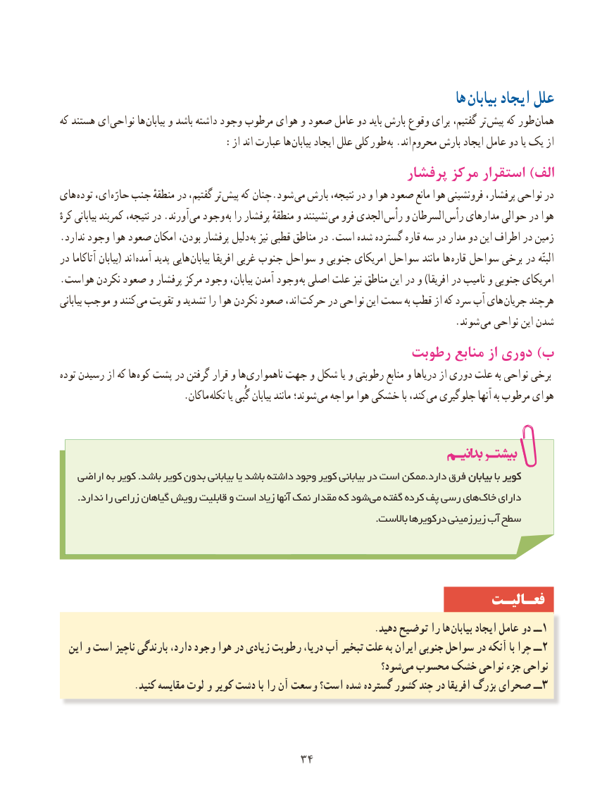

# PDF page 42

ها بیابان ایجاد علل
که هستند ای نواحی ها بیابان و باشد داشته وجود مرطوب هوای و صعود عامل دو باید بارش وقوع برای گفتیم، تر  پیش که طور همان
     : از اند عبارت ها بیابان ایجاد علل کلی طور به .اند محروم بارش ایجاد عامل دو یا یک از
                                                   پرفشار مرکز استقرار )الف
های توده ای، حارّه جنب منطقهٔ در گفتیم، تر پیش که  چنان.شود  می بارش نتیجه، در و هوا صعود مانع هوا فرونشینی پرفشار، نواحی در
کرهٔ بیابانی کمربند نتیجه، در .آورند  می وجود به را پرفشار منطقهٔ و نشینند می فرو الجدی  رأس و السرطان رأس مدارهای حوالی در هوا
. ندارد وجود هوا صعود امکان بودن، پرفشار دلیل به نیز قطبی مناطق در .است شده گسترده قاره سه در مدار دو این اطراف در زمین
در آتاکاما بیابان( اند  آمده پدید هایی بیابان افریقا غربی جنوب سواحل و جنوبی امریکای سواحل مانند ها قاره سواحل برخی در البتّه
. هواست نکردن صعود و پرفشار مرکز وجود بیابان، آمدن وجود به اصلی علت نیز مناطق این در و )افریقا در نامیب و جنوبی امریکای
بیابانی موجب و کنند می تقویت و تشدید را هوا نکردن صعود اند، حرکت در نواحی این سمت به قطب از که سرد آب های  جریان هرچند
                             . شوند می نواحی این شدن
                                             رطوبت منابع از دوری )ب
توده رسیدن از که ها کوه پشت در گرفتن قرار و ها ناهمواری جهت و شکل یا و رطوبتی منابع و دریاها از دوری علت به نواحی برخی
         . ماکان تکله یا گُبی بیابان مانند شوند؛ می مواجه هوا خشکی با کند، می جلوگیری آنها به مرطوب هوای

   اراضی به کویر .باشد کویر بدون بیابانی یا باشد داشته وجود کویر بیابانی در است ممکن.دارد فرق بیابانبیابان با کویرکویر
      .ندارد را زراعی گیاهان رویش قابلیت و است زیاد آنها نمک مقدار که شود می گفته کرده پف رسی های خاک دارای
                                                                                                   .باالست درکویرها زیرزمینی آب سطح

                                                                 فعـالیـت
                                                                     .دهید توضیح را ها بیابان ایجاد عامل دو ــ 1
  این و است ناچیز بارندگی دارد، وجود هوا در زیادی رطوبت دریا، آب تبخیر علت به ایران جنوبی سواحل در آنکه با چرا ــ2
                                                               شود؟‌می محسوب خشک نواحی جزء نواحی
                .کنید مقایسه لوت و کویر دشت با را آن وسعت است؟ شده گسترده کشور چند در افریقا بزرگ صحرای ٣ــ

                                    3434

