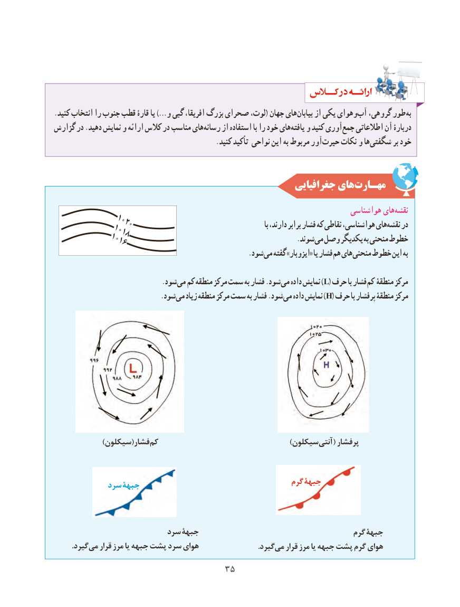

# PDF page 43

.کنید انتخاب را جنوب قطب قارۀ یا …)و گبی افریقا، بزرگ صحرای لوت،( جهان هایبیابان‌     از یکی وهوایآب‌  گروهی، طور به
گزارش در .دهید نمایش و ارائه کالس در مناسب هایرسانه‌     از استفاده با را خود هاییافته‌   و کنید آوریجمع‌   اطالعاتی آن دربارۀ
           . کنید کید تأ نواحی این به مربوط آورحیرت‌    نکات و هاشگفتی‌        بر خود

                                                     جغرافیایی هایمهـارت‌
                                                                             هواشناسی هاینقشه‌
           10201020                                                           با دارند، برابر فشار که نقاطی هواشناسی، هاینقشه‌   در          10181018          10161016                 .‌شوندمی وصل یکدیگر به منحنی خطوط
                      .‌شودمی گفته »ایزوبار« یا فشار هم های منحنی خطوط این به

            .‌شودمی کم منطقه مرکز سمت به فشار .شودمی‌)داده نمایش L( حرف با فشار کم منطقۀ مرکز
            .‌شودمی زیاد منطقه مرکز سمت به فشار .شودمی‌)داده نمایش H( حرف با پرفشار منطقۀ مرکز

               ))سیکلونسیکلون((فشارفشار  کمکم                                          ))سیکلونسیکلونآنتیآنتی‌‌    (( پرفشارپرفشار

                                                          گرمگرم جبهۀجبهۀ            سردسرد جبهۀجبهۀ

                        سردسرد جبهۀجبهۀ                                      گرمگرم جبهۀجبهۀ
         ..گیردگیردمیمی‌‌   قرارقرار مرزمرز یایا جبههجبهه پشتپشت سردسرد هوایهوای                               ..گیردگیردمیمی‌‌   قرارقرار مرزمرز یایا جبههجبهه پشتپشت گرمگرم هوایهوای
                                 3535

