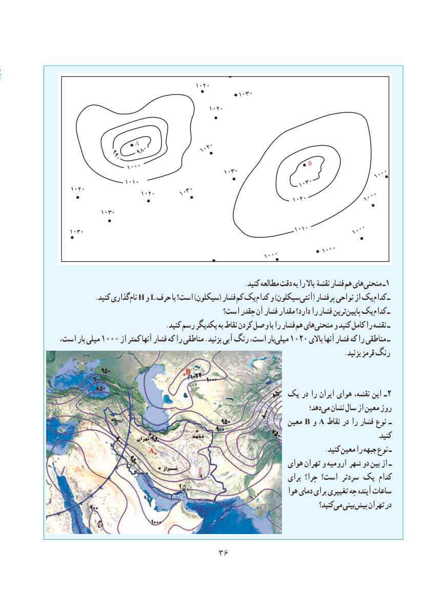

# PDF page 44

1020
                                                    1030

                                              1020

                     A
                      980             1020                 990
                                                                 B                     1000
                                                1030                                  1000
                      1010                                        1030
       1020                           1020      1030                                                                  1020              1000

                1030

                                                                  1010       1030                                                                   1000

                                                                       1000
                                                        1000

                                                            .کنید مطالعه دقت به را باال نقشۀ‌    فشار هم های منحنی ـ1
               .کنید گذاری نام H و L حرف با است؟ )سیکلون( فشار کم یک کدام و )سیکلونآنتی‌     ( پرفشار نواحی از یک کدام ـ
                                           است؟ چقدر آن فشار مقدار دارد؟ را فشار ترینپایین‌  یک کدام ـ
  . کنید رسم یکدیگر به نقاط کردن وصل با را فشارهم های منحنی و کنید کامل را نقشه ـ
    است، بار میلی 1000 از کمتر آنها فشار که را مناطقی .بزنید آبی رنگ است، بارمیلی‌   1020 باالی آنها فشار که را مناطقی ـ
                                                                                                                          . بزنید قرمز رنگ

                                          یک در را ایران هوای نقشه، این ـ 2
                                                                                     دهد؛می‌  نشان سال از معین روز
                                                                   معین B و A نقاط در را فشار نوع ـ
                                                                                                    .کنید
                                                                                    .کنید معین را جبهه نوع ـ
1000                                                          هوای تهران و ارومیه شهر دو بین از ـ
                                        900                       برای چرا؟ است؟ سردتر یک کدام
                             950                                        1000      هوا دمای برای تغییری چه آینده ساعات                            1000                                                                                               کنید؟ می بینی پیش تهران در
        950

                                    3636

