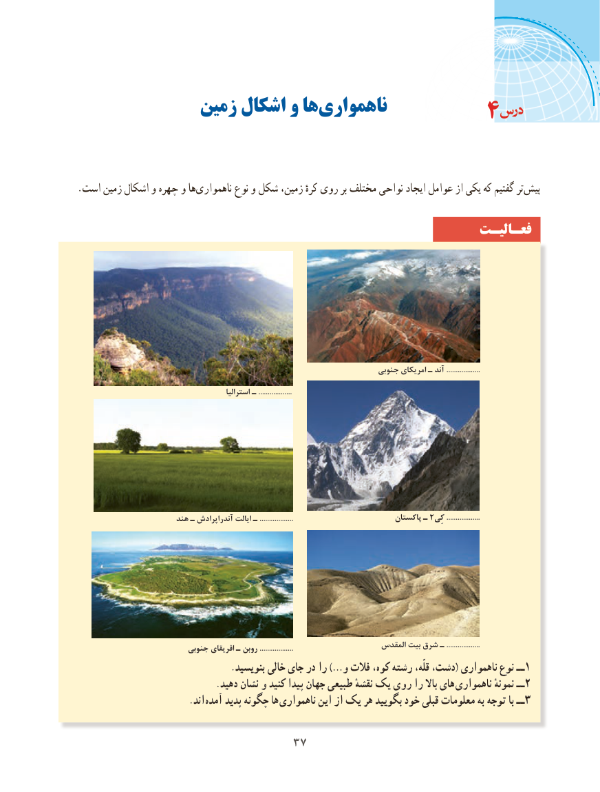

# PDF page 45

زمین اشکال و ها ‌ناهمواری                                4

.است زمین اشکال و چهره و هاناهمواری‌        نوع و شکل زمین، کرهٔ روی بر مختلف نواحی ایجاد عوامل از یکی که گفتیم تر پیش

                                                              فعـالیـت

                                                                         جنوبی امریکای ـ آند ..................
                                                 استرالیا ـ ..................

                        هند ـ آندراپرادش ایالت ـ ..................                           پاکستان ـ 2..................کِی

                           جنوبی افریقای ـ روبن ..................                     المقدس بیت شرق ـ ..................
                                  .بنویسید خالی جای در را …)و فالت کوه، رشته قلّه، دشت،( ناهمواری نوع ــ1
                               .دهید نشان و کنید پیدا جهان طبیعی نقشهٔ یک روی را باال های  ناهمواری نمونهٔ ــ2
                         .اند  آمده پدید چگونه ها ناهمواری این از یک هر بگویید خود قبلی معلومات به توجه با ــ 3

                               3737

