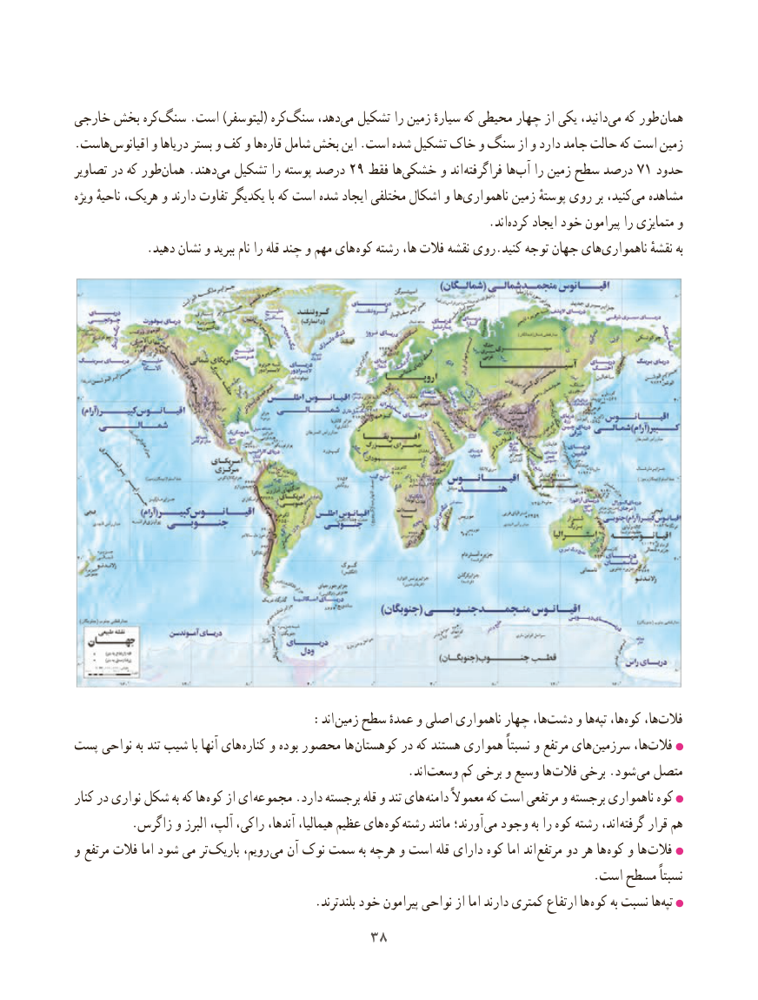

# PDF page 46

خارجی بخش کرهسنگ‌     .است )لیتوسفر( کره‌سنگ دهد،‌می تشکیل را زمین سیارهٔ که محیطی چهار از یکی دانید،‌می که طور همان
.هاست‌اقیانوس و دریاها بستر و کف و ها ‌قاره شامل بخش این .است شده تشکیل خاک و سنگ از و دارد جامد حالت که است زمین
تصاویر در که طور‌همان .دهندمی‌  تشکیل را پوسته درصد 29 فقط ها‌خشکی و اند  فراگرفته ها‌آب را زمین سطح درصد 71 حدود
ویژه ناحیهٔ هریک، و دارند تفاوت یکدیگر با که است شده ایجاد مختلفی اشکال و هاناهمواری‌        زمین پوستهٔ روی بر کنید،می‌  مشاهده
                                                                    .اند‌کرده ایجاد خود پیرامون را متمایزی و
            .دهید نشان و ببرید نام را قله چند و مهم های کوه رشته ها، فالت نقشه روی.کنید توجه جهان هایناهمواری‌          نقشهٔ به

                    : اند زمین سطح عمدهٔ و اصلی ناهمواری چهار ها،دشت‌    و هاتپه‌  ها،کوه‌   ها، ‌فالت
پست نواحی به تند شیب با آنها های کناره و بوده محصور ها کوهستان در که هستند همواری نسبتاً و مرتفع های سرزمین ها،فالت‌
                                                       .اند  وسعت کم برخی و وسیع ها  فالت برخی .شود  می متصل
کنار در نواری شکل به که ها کوه از ای مجموعه .دارد برجسته قله و تند های  دامنه معموالً که است مرتفعی و برجسته ناهمواری کوه
         .زاگرس و البرز آلپ، راکی، آندها، هیمالیا، عظیم های کوه  رشته مانند آورند؛  می وجود به را کوه رشته اند،  گرفته قرار هم
و مرتفع فالت اما شود می تر  باریک رویم، می آن نوک سمت به هرچه و است قله دارای کوه اما اند مرتفع دو هر ها  کوه و ها  فالت
                                                                                     .است مسطح نسبتاً
  . بلندترند خود پیرامون نواحی از اما دارند کمتری ارتفاع ها کوه به نسبت هاتپه‌
                                 3838

