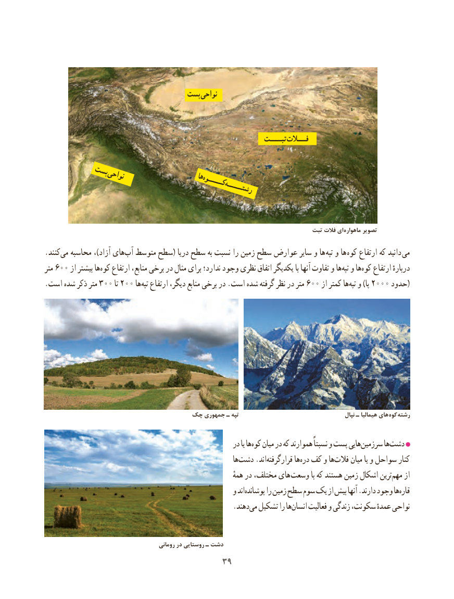

# PDF page 47

پستپست نواحینواحی

                                                                     تبــــتتبــــت فـــالتفـــالت

         پستپست               نواحینواحی               هاها                                               کـــــوهکـــــوه                                                    رشتـــــهرشتـــــه

                                                                               تبت فالت ای ماهواره تصویر
.کنند‌می محاسبه ،)آزاد های‌آب متوسط سطح( دریا سطح به نسبت را زمین سطح عوارض سایر و ها ‌تپه و ها  ‌کوه ارتفاع که دانید  می
متر 600 از بیشتر هاکوه‌   ارتفاع منابع، برخی در مثال برای ندارد؛ وجود نظری اتفاق یکدیگر با آنها تفاوت و هاتپه‌  و هاکوه‌   ارتفاع ‌ٔدرباره
.است شده ذکر متر 300 تا 200 ها ‌تپه ارتفاع دیگر، منابع برخی در .است شده گرفته نظر در متر 600 از کمتر ها ‌تپه و )پا 2000 حدود(

                           چک جمهوری ـ تپه                                           نپال ـ هیمالیا های کوه رشته

                                                      در یا هاکوه‌   میان در که هموارند نسبتاً و پست هاییسرزمین‌       هادشت‌
                                                                 هادشت‌    .اندقرارگرفته‌         هادره‌  کف و هافالت‌     میان یا و سواحل کنار
                                                                         همهٔ در مختلف، های وسعت با که هستند زمین اشکال ترینمهم‌    از
                                                    و اندپوشانده‌       را زمین سطح سوم یک از بیش آنها .دارند وجود هاقاره‌
                    .‌دهندمی تشکیل را هاانسان‌     فعالیت و زندگی سکونت، عمدهٔ نواحی

                                           رومانی در روستایی ـ دشت
                                    3939

