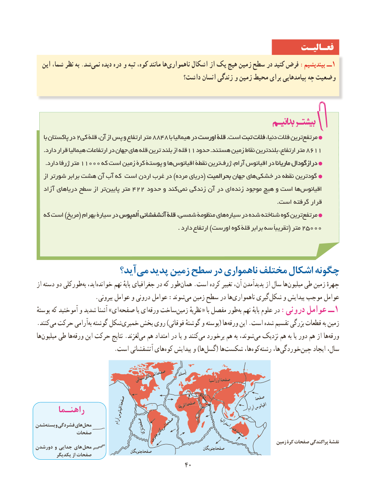

# PDF page 48

فعـالیـت
  این شما، نظر به .شد‌نمی دیده دره و تپه کوه، مانند ها ناهمواری‌       اشکال از یک ‌هیچ زمین سطح در کنید فرض :بیندیشیم ــ1
                                            داشت؟ انسان زندگی و زمین محیط برای پیامدهایی چه وضعیت

     با پاکستان در 2کی قلة آن، از پس و ارتفاع متر 8848 با هیمالیا در اورستاورست قلةقلة .است تبتتبت فالتفالت دنیا، فالت ترینمرتفع‌
    .دارد قرار هیمالیا ارتفاعات در جهان های قله ترین بلند از قله11 حدود .هستند زمین نقاط بلندترین ارتفاع، متر 8611
     .دارد ژرفا متر 11000 که است زمین کرة پوستة و هااقیانوس‌       نقطة ترینژرف‌    آرام، اقیانوس در نانا  ماریاماریا درازگودالدرازگودال
   از شورتر برابر هشت‌    آن آب که است اردن غرب در )مرده دریای( بحرالمیتبحرالمیت جهان های خشکی در نقطه گودترین
   زاد آ دریاهای سطح از تر‌پایین متر 422 حدود و کند  نمی زندگی آن در ای‌زنده موجود ‌هیچ و است هااقیانوس‌
                                                                                                                            .است گرفته قرار
   که است )مریخ( بهرام سیارة در اُلمپوساُلمپوس آتشفشانیآتشفشانی قلةقلة شمسی، منظومة های سیاره در شده شناخته کوه ترینمرتفع‌
                                                                         . دارد ارتفاع )اورست کوه قلة برابر سه تقریباً( متر 25000

                    آید؟می‌  پدید زمین سطح در ناهمواری‌      مختلف اشکال چگونه
 از دسته دو طورکلی‌به اید،‌خوانده نهم پایهٔ جغرافیای در که طور ‌همان .است کرده تغییر آن، پدیدآمدن از سال هامیلیون‌    طی زمین چهرهٔ
 .‌بیرونی عوامل و درونی عوامل :شوندمی زمین سطح در هاناهمواری‌       گیری‌شکل و پیدایش موجب عوامل
 پوستهٔ که آموختید و شدید آشنا » ای صفحه یا ای‌ورقه ساخت‌زمین نظریهٔ « با مفصل طور‌به نهم پایهٔ علوم در :درونی عوامل ــ 1
 .کنندمی‌  حرکت آرامی‌به گوشته شکل‌خمیری بخش روی )فوقانی گوشتهٔ و پوسته( هاورقه‌    این .است شده تقسیم بزرگی قطعات به زمین
 ها‌میلیون طی ها‌ورقه این حرکت نتایج .لغزند‌می هم امتداد در یا و کنندمی‌  برخورد هم به شوند،می‌  نزدیک هم به یا دور هم از ها‌ورقه
   .‌است آتشفشانی هایکوه پیدایش و )هاگسل‌     ( هاشکست‌        ها،کوه‌    ‌رشته ها،خوردگی‌            ‌چین ایجاد سال،

                                          صفحۀ     آىسلند                                                     امرىکاى                                             شمالى                                     اوراسىاصفحۀ

                                                                             صفحۀ                               صفحۀ                                                     صفحۀ عربستان                                                                                                  آراماقىانوس      راهنـما                   اقىانوس                               افرىقا
شدنبسته     و فشردگى هاىمحل                                 آرام     صفحۀ     صفحۀ                        استرالىاو                                                                  هند         تصفحا                             نازکا   امرىکاى                                                               صفحۀ                                              جنوبى                                                                                                 زمین کرۀ صفحات پراکندگی نقشۀ
دورشدن و جدایى هاى  محل                                                                 جنوبگانصفحۀ                                                       جنوبگانصفحۀ        یکدیگر از صفحات
                                             4040

