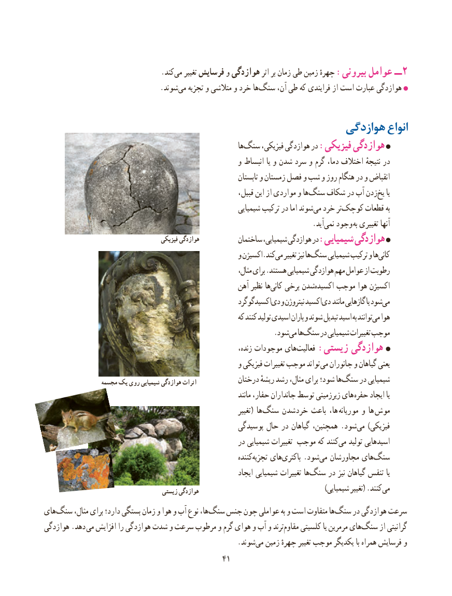

# PDF page 49

.کندمی‌   تغییر فرسایش و هوازدگی اثر بر زمان طی زمین چهرهٔ :بیرونی عوامل ــ 2
                                .شوند‌می تجزیه و متالشی و خرد هاسنگ‌     آن، طی که فرایندی از است عبارت هوازدگی

                                                     هوازدگی انواع
                                                                    هاسنگ‌     فیزیکی، هوازدگی در :فیزیکی هوازدگی
                                                      و انبساط یا و شدن سرد و گرم دما، اختالف نتیجهٔ در
                                                                    تابستان و زمستان فصل و شب و روز هنگام در و انقباض
                                                              قبیل، این از مواردی و ها‌سنگ شکاف در آب زدنیخ‌   یا
                                                             شیمیایی ترکیب در اما شوند‌می خرد تر‌کوچک قطعات به
                                        .‌آیدنمی وجود  به تغییری آنها
                                         فیزیکی هوازدگی                                                        ساختمان شیمیایی، هوازدگی در :شیمیایی هوازدگی
                                                      و اکسیژن.کندمی‌   تغییر نیز هاسنگ‌     شیمیایی ترکیب و هاکانی‌
                                                                      مثال، برای .هستند شیمیایی هوازدگی مهم عوامل از رطوبت
                                                       آهن نظیر هاکانی‌   برخی شدناکسیده‌    موجب هوا اکسیژن
                                                          اکسیدگوگرددی‌  و نیتروژن اکسیددی‌   مانند گازهایی یا شودمی‌
                                                             که کنند تولید اسیدی باران و شوند تبدیل اسید به توانندمی‌  هوا
                           . شودمی هاسنگ‌    در شیمیایی تغییرات موجب
                                                                     زنده، موجودات هایفعالیت‌    :زیستی هوازدگی
                                                      و فیزیکی تغییرات موجب تواند می جانوران و گیاهان یعنی
                  مجسمه یک روی شیمیایی هوازدگی اثرات            درختان ریشهٔ رشد مثال، برای شود؛ هاسنگ‌     در شیمیایی
                                                                           مانند حفار، جانداران توسط زیرزمینی های حفره ایجاد یا
                                                                            تغییر ( ها‌سنگ خردشدن باعث ها،  موریانه و ها  موش
                                                     پوسیدگی حال در گیاهان همچنین، . شود‌می ) فیزیکی
                                                       در شیمیایی تغییرات موجب که کنندمی‌   تولید اسیدهایی
                                                                   کنندهتجزیه‌    هایباکتری‌     .شودمی‌  مجاورشان هایسنگ‌
                                                                 ایجاد شیمیایی تغییرات هاسنگ‌     در نیز گیاهان تنفس یا
                                       زیستی هوازدگی    ) شیمیایی تغییر( .کنند می
های‌سنگ مثال، برای دارد؛ بستگی زمان و هوا و آب نوع ها،‌سنگ جنس چون عواملی به و است متفاوت ها‌سنگ در هوازدگی سرعت
هوازدگی .دهد می افزایش را هوازدگی شدت و سرعت مرطوب و گرم هوای و آب و ترند ‌مقاوم کلسیتی یا مرمرین های‌سنگ از گرانیتی
                   .‌شوندمی زمین چهرهٔ تغییر موجب یکدیگر با همراه فرسایش و
                                             4141

