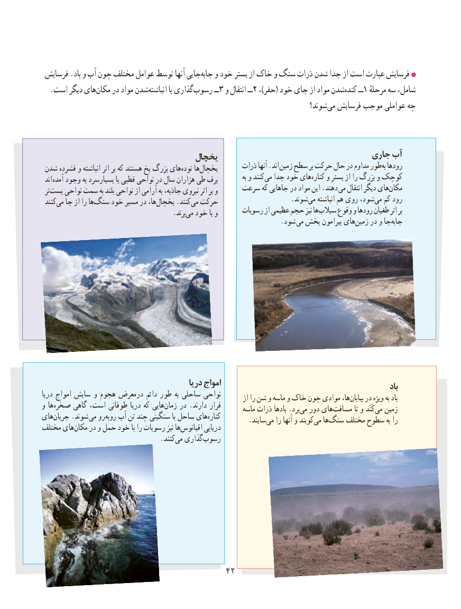

# PDF page 50

فرسایش .باد و آب چون مختلف عوامل توسط آنها جاییجابه‌   و خود بستر از خاک و سنگ ذرات شدن جدا از است عبارت فرسایش
  .است دیگر هایمکان‌    در مواد شدنانباشته‌         یا گذاریرسوب‌        ــ 3 و انتقال ــ2 ،)حفر( خود جای از مواد شدنکنده‌     ــ1 مرحلهٔشامل،سه
                                                                            شوند؟ ‌می فرسایش موجب عواملی چه

                                                                      جاری آب‌                                 یخچال                                                       ذرات آنها .اند زمین سطح بر حرکت حال در مداوم طوربه‌ رودها شدن ‌ فشرده و انباشته اثر بر که هستند یخ بزرگ های ‌توده ها‌یخچال                                                                                              به و کنند‌می جدا خود های‌کناره و بستر از را بزرگ و کوچک اند آمده وجود به بسیارسرد یا قطبی نواحی در سال هزاران طی برف                                            سرعت که جاهایی در مواد این .دهند می انتقال دیگر هایمکان‌ تر‌پست نواحی سمت به بلند نواحی از آرامی به جاذبه، نیروی اثر بر و                          .‌شوندمی انباشته هم روی شود،می‌  کم رود کنندمی‌  جا از را هاسنگ‌    خود مسیر در ها،‌یخچال .کنندمی‌  حرکت                                                         رسوبات از عظیمی حجم نیز هاسیالب‌     وقوع و رودها طغیان اثر بر                 .‌برند می خود با و                            . شود می پخش پیرامون هایزمین‌    در و جاجابه‌

                                            دریا امواج                                                                                                                       باددریا امواج سایش و هجوم درمعرض دائم طور به ساحلی نواحی                                                                        از را شن و ماسه و خاک چون موادی ها،بیابان‌    در ویژه ‌به بادو ها ‌صخره گاهی است، طوفانی دریا که هایی‌زمان در . دارند قرار                                                                 ماسه ذرات بادها .برد ‌می دور های‌مسافت تا و کَنَد‌می زمینهای‌جریان .شوند  می رو‌روبه آب تن چند سنگینی با ساحل هایکناره‌                     .‌سایند می را آنها و کوبندمی‌   ها‌سنگ مختلف سطوح به رامختلف های‌مکان در و حمل خود با را رسوبات نیز هااقیانوس‌        دریایی
              .‌کنند می گذاری‌رسوب

                                       4242

