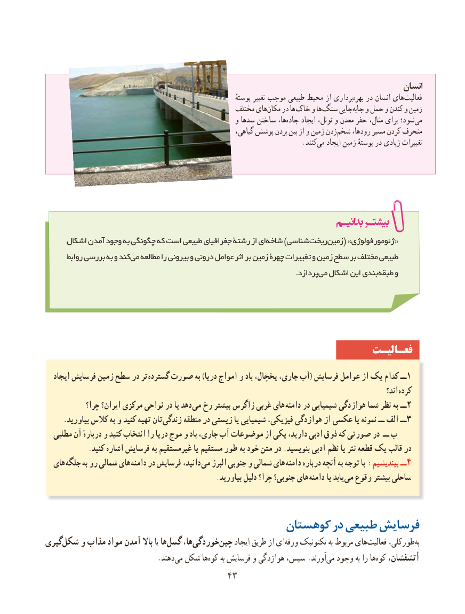

# PDF page 51

انسان
                                                                          پوستهٔ تغییر موجب طبیعی محیط از برداریبهره‌   در انسان های‌فعالیت
                                                 مختلف هایمکان‌    در ها خاک و ها سنگ جاییجابه‌   و حمل و کندن و زمین
                                                       و سدها ساختن ها،جاده‌     ایجاد تونل، و معدن حفر مثال، برای شود؛ ‌می
                                                              گیاهی، پوشش بردن بین از و زمین زدنشخم‌    رودها، مسیر کردن منحرف
                               .‌کنندمی ایجاد زمین پوستهٔ در زیادی تغییرات

     اشکال آمدن وجود به چگونگی که است طبیعی جغرافیای رشتة از ایشاخه‌     )شناسیریخت‌    زمین‌    ( »ژئومورفولوژی «
       روابط بررسی به و کندمی‌  مطالعه را بیرونی و درونی عوامل اثر بر زمین چهرة تغییرات و زمین سطح بر مختلف طبیعی
                    .‌پردازدمی اشکال این بندی‌ طبقه و

                                                                 فعـالیـت
   ایجاد فرسایش زمین سطح در تر گسترده صورت به )دریا امواج و باد یخچال، جاری، آب( فرسایش عوامل از یک کدام ــ1
                                                                                                                       اند؟ کرده
            چرا؟ ایران؟ مرکزی نواحی در یا دهد  می رخ بیشتر زاگرس غربی های دامنه در شیمیایی هوازدگی شما نظر به ــ 2
     .بیاورید کالس به و کنید تهیه تان  زندگی منطقه در زیستی یا شیمیایی فیزیکی، هوازدگی از عکسی یا نمونه ــ الف ــ 3
  مطلبی آن دربارهٔ و کنید انتخاب را دریا موج و باد جاری، آب موضوعات از یکی دارید، ادبی ذوق که صورتی در ــ ب
            .کنید اشاره فرسایش به غیرمستقیم یا مستقیم طور به خود متن در .بنویسید ادبی نظم یا نثر قطعه یک قالب در
  های جلگه به رو شمالی های  دامنه در فرسایش  ،دانید می البرز جنوبی و شمالی های دامنه درباره آنچه به توجه با :بیندیشیم ــ 4
                                                 .بیاورید دلیل چرا؟ جنوبی؟ های دامنه یا یابد می وقوع بیشتر ساحلی

                                     کوهستان در طبیعی فرسایش
گیری‌شکل و مذاب مواد آمدن باال یا هاگسل‌     ها،خوردگی‌            ‌چین ایجاد طریق از ای ‌ورقه تکتونیک به مربوط های ‌فعالیت طورکلی،‌به
            .‌دهند می شکل هاکوه‌    به فرسایش و هوازدگی سپس، .آورندمی‌  وجود به را هاکوه‌   آتشفشان،
                                    4343

