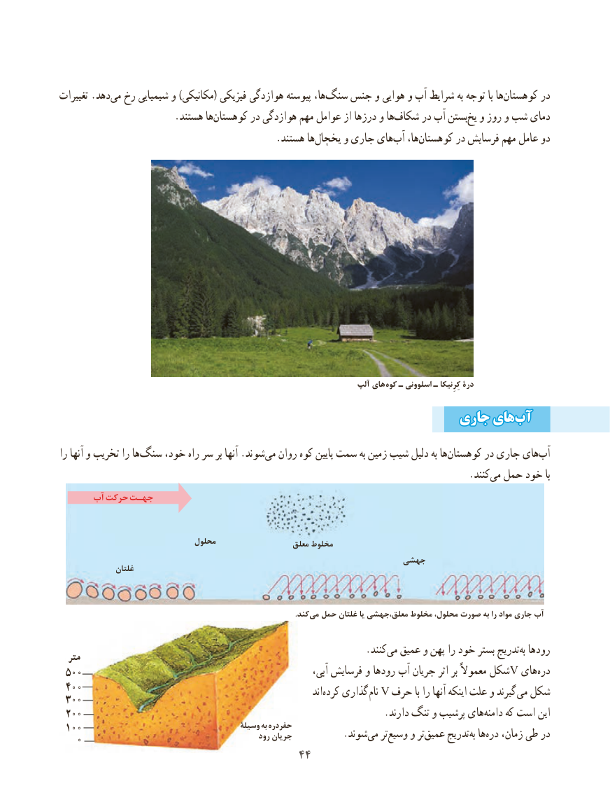

# PDF page 52

تغییرات .دهدمی‌  رخ شیمیایی و )مکانیکی( فیزیکی هوازدگی پیوسته ها،‌سنگ جنس و هوایی و آب شرایط به توجه با ها‌کوهستان در
                        .هستند هاکوهستان‌       در هوازدگی مهم عوامل از درزها و هاشکاف‌     در آب بستنیخ‌  و روز و شب دمای
                                            .هستند هایخچال‌     و جاری هایآب‌   ها، ‌کوهستان در فرسایش مهم عامل دو

                                                                       آلپ های کوه ـ اسلوونی ـ کِرِنیکا درۀ
                                                     جاریجاری هایهایآبآب‌‌
را آنها و تخریب را هاسنگ‌    خود، راه سر بر آنها .شوندمی‌  روان کوه پایین سمت به زمین شیب دلیل به هاکوهستان‌       در جاری های ‌آب
                                   .‌کنندمی حمل خود با
      آب حرکت جهـت

                               محلول                   معلق مخلوط
                                                            جهشی               غلتان

                             .‌کندمی حمل غلتان یا معلق،جهشی مخلوط محلول، صورت به را مواد جاری آب

                          .‌کنند می عمیق و پهن را خود بستر تدریجبه‌ رودها  مترمتر
 500500                                                           آبی، فرسایش و رودها آب جریان اثر بر معموالً شکلV های‌دره
 400400                                                                   اند‌کرده گذاری نام V حرف با را آنها اینکه علت و گیرند می شکل 300300
 200200      .‌دارند تنگ و پرشیب هایدامنه که است این
 100100                                        وسیلۀ به حفردره                                                     رود جریان    .‌شوند می تروسیع‌    و ترعمیق‌     تدریجبه‌  ها ‌دره زمان، طی در   0
                                      4444

