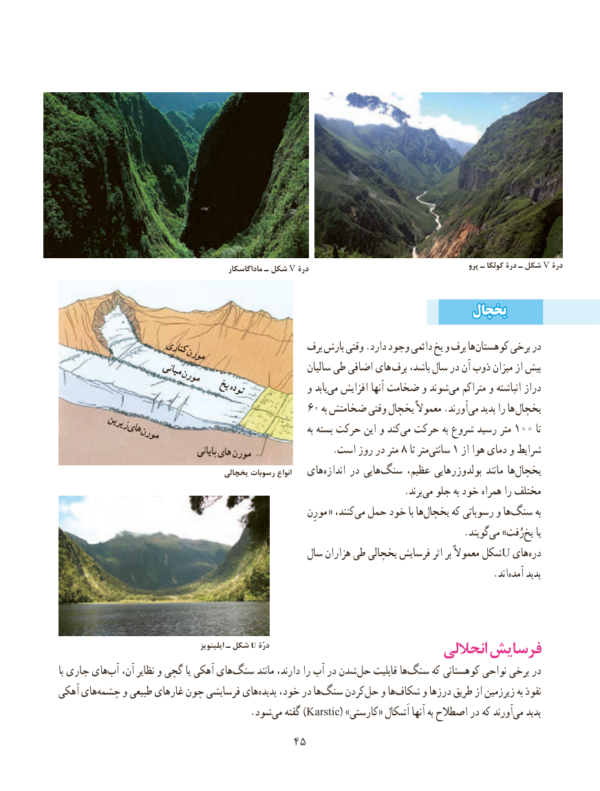

# PDF page 53

پرو ـ کولکا درۀ ـ شکل V درۀ                                                 ماداگاسکار ـ شکل V درۀ

                                                            یخچالیخچال
                    کناریکناری                       برف بارش وقتی .دارد وجود دائمی یخ و برف هاکوهستان‌      برخی در                    مورنمورن
                    میانیمیانی                               سالیان طی اضافی های برف باشد، سال در آن ذوب میزان از بیش                   مورنمورن                     یخیخ                                تودهتوده            و یابدمی‌  افزایش آنها ضخامت و شوندمی‌   متراکم و انباشته دراز
                                         60 به ضخامتش وقتی یخچال معموالً .آورند ‌می پدید را ها یخچال
         زیرینزیرین          هایهای                                                       به بسته حرکت این و کندمی‌  حرکت به شروع رسید متر 100 تا             مورنمورن
                                       پایانیپایانیهایهایمورنمورن  .8است روز در متر    تا مترسانتی‌    1 از هوا دمای و شرایط
                                         یخچالی رسوبات انواع   های ‌اندازه در هایی ‌سنگ عظیم، بولدوزرهایی مانند ها‌یخچال
                                 .‌برند می جلو به خود همراه را مختلف
                                                              مورِن « ،کنندمی‌  حمل خود با هایخچال‌      که رسوباتی و هاسنگ‌       به
                                                                                    .گویند‌می »رُفت‌یخ یا
                                                سال هزاران طی یخچالی فرسایش اثر بر معموالً شکلU های‌دره
                                                  .‌اند آمده پدید

                                              ایلینویز ـ شکل U درّۀ                                                            انحاللی فرسایش
با جاری هایآب‌   آن، نظایر و گچی یا آهکی های‌سنگ مانند دارند، را آب در شدنحل‌    قابلیت هاسنگ‌     که کوهستانی نواحی برخی در
آهکی های ‌چشمه و طبیعی غارهای چون فرسایشی های ‌پدیده خود، در هاسنگ‌    کردنحل‌   و ها‌شکاف و درزها طریق از زیرزمین به نفوذ
          .‌)شودمی گفته Karstic( »کارستی« اَشکال آنها به اصطالح در که آورندمی‌   پدید
                                    4545

