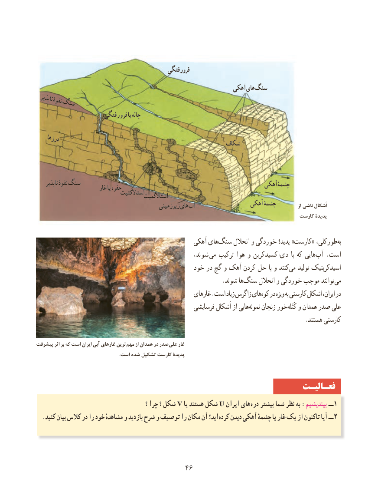

# PDF page 54

فرورفتگیفرورفتگی
                                                             آهکیآهکی هایهای  سنگسنگ
 ناپذیرناپذیر     نفوذنفوذ     سنگسنگ
                        فرورفتگیفرورفتگی یایا چالهچاله

   درزهادرزها                                                    شکافشکاف

     ناپذیرناپذیر نفوذنفوذ سنگسنگ                                                         آهکیآهکی چشمۀچشمۀ                         غارغار یایا حفرهحفره                                  استاالکتیتاستاالکتیت                                           استاالگمیتاستاالگمیت
                                                                  آهکیآهکی   چشمۀچشمۀ             از ناشی اَشکال                                               زیرزمینیزیرزمینی هایهای آبآب
                                                                                           کارست پدیدۀ

                                                 آهکی های ‌سنگ انحالل و خوردگی‌ ٔطورکلی،پدیده »کارست«              ‌به
                                                     شوند،  می ترکیب هوا و اکسیدکربن ‌دی  با که هایی‌آب . است
                                            خود در گچ و آهک کردن حل با و کنندمی‌   تولید اسیدکربنیک
                .‌شوند ها سنگ انحالل و خوردگی موجب توانندمی‌
                                                      غارهای. است زیاد زاگرس هایکوه‌  در ویژه به‌ کارستی اشکال ایران، در
                                                     فرسایشی اَشکال از هایینمونه‌    زنجان خورکَتَله‌   و همدان صدر علی
                                                                                         .هستند کارستی

پیشرفت اثر بر که است ایران آبی غارهای ترین  مهم از همدان در صدر  علی غار
                                                                      .است شده تشکیل کارست پدیدۀ

                                                                 فعـالیـت
                                                 ؟ چرا ؟ شکل V یا هستند شکل U ایران های  دره بیشتر شما نظر به :بیندیشیم ــ 1
  .کنید بیان کالس در را خود مشاهدهٔ و بازدید شرح و توصیف را مکان آن اید؟ کرده دیدن آهکی چشمهٔ یا غار یک از تاکنون آیا ــ 2

                                      4646

