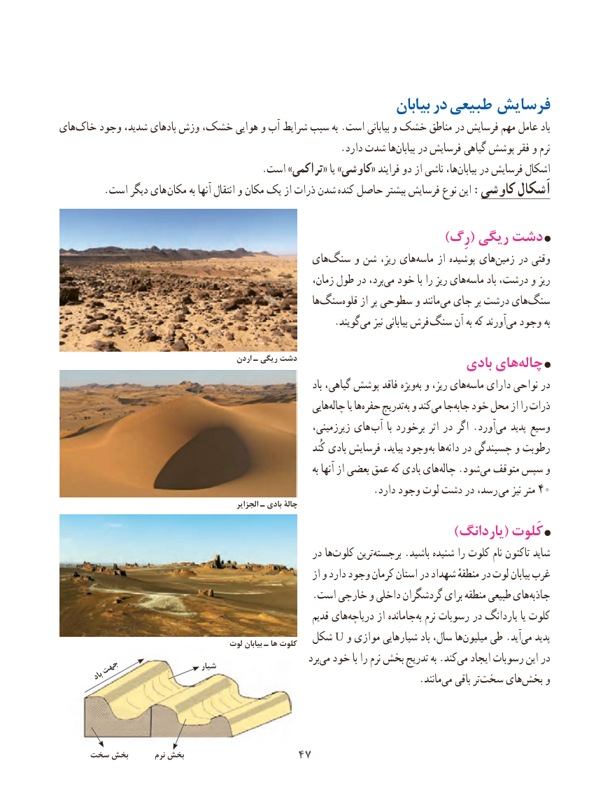

# PDF page 55

‌بیابان در طبیعی فرسایش
های‌خاک وجود شدید، بادهای وزش خشک، هوایی و آب شرایط سبب به .است بیابانی و خشک مناطق در فرسایش مهم عامل باد
          .‌دارد شدت هابیابان در فرسایش گیاهی پوشش فقر و نرم
                                         .است »تراکمی « یا »کاوشی« فرایند دو از ناشی ها،بیابان‌    در فرسایش اشکال
 . است دیگر های مکان به آنها انتقال و مکان یک از ذرات شدن ‌کنده حاصل بیشتر فرسایش نوع این :کاوشی اَشکال

                                                                      )رِگ( ریگی دشت
                                               های‌سنگ و شن ریز، های‌ماسه از پوشیده های‌زمین در وقتی
                                                          زمان، طول در برد،می‌  خود با را ریز های‌ماسه باد درشت، و ریز
                                                                 ها ‌سنگ ‌قلوه از پر سطوحی و مانندمی‌  جای بر درشت های‌سنگ
                   .‌گویندمی نیز بیابانی فرش  سنگ آن به که آورندمی‌  وجود به
                                              اردن ـ ریگی دشت                          بادی هایچاله‌
                                                                              باد گیاهی، پوشش فاقد ویژهبه‌ و ریز، های‌ماسه دارای نواحی در
                                                            هاییچاله‌      یا هاحفره‌    تدریجبه‌ و کندمی‌  جاجابه‌   خود محل از را ذرات
                                                            زیرزمینی، های  آب  با برخورد اثر در اگر . آورد ‌می پدید وسیع
                                                                             کُند بادی فرسایش بیاید، وجود به هادانه‌   در چسبندگی و رطوبت
                                                                                   به آنها از بعضی عمق که بادی های‌چاله .شود‌می متوقف سپس و
                                                                .دارد وجود لوت دشت در رسد، می نیز متر 40
                                                        الجزایر ـ بادی چالۀ
                                                                        )یاردانگ( کَلوت
                                                     در هاکلوت‌     ترینبرجسته‌      .باشید شنیده را ‌کلوت نام تاکنون شاید
                                                                از و دارد وجود کرمان استان در شهداد منطقهٔ در لوت بیابان غرب
  .‌است خارجی و داخلی گردشگران برای منطقه طبیعی های جاذبه
                                                              قدیم های‌دریاچه از جامانده ‌به نرم رسوبات در یاردانگ یا کلوت
                                       لوت بیابان ـ ها کلوت  شکل U و موازی شیارهایی باد سال، ها ‌میلیون طی .آید‌می پدید
                                                                   برد‌می خود با را نرم بخش تدریج به .کندمی‌   ایجاد رسوبات این در     جهت                     شیار     باد                         .‌مانندمی ‌باقی تر ‌سخت های‌بخش و

     سخت بخش        نرم بخش                 4747

