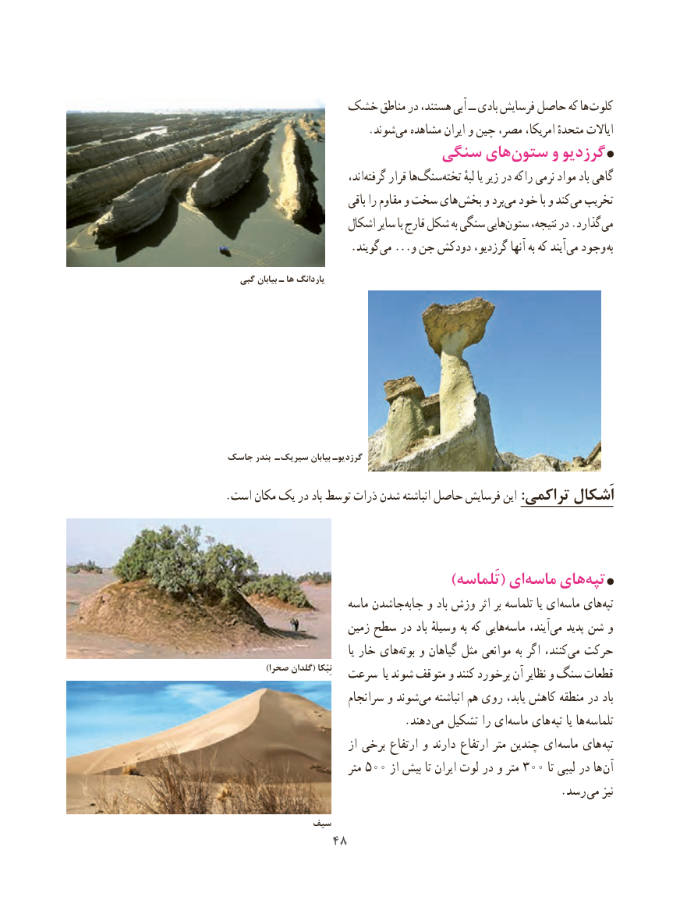

# PDF page 56

خشک مناطق در هستند، آبی ــ بادی فرسایش حاصل که ها کلوت
                          .شوند ‌می مشاهده ایران و چین مصر، امریکا، متحدهٔ ایاالت
                     سنگی هایستون‌     و گرزدیو
                               ،اند‌گرفته قرار ها‌سنگ ‌تخته لبهٔ یا زیر در راکه نرمی مواد باد گاهی
                            باقی را مقاوم و سخت های  بخش و برد‌می خود با و کندمی‌  تخریب
                      اشکال سایر یا قارچ شکل به سنگی هاییستون‌     نتیجه، در .گذارد می
        .‌گویند می ...و جن دودکش گرزدیو، آنها به که آیند می وجود  به

   گبی بیابان ـ ها یاردانگ

جاسک بندر ـ سیریک بیابان گرزدیوـ
.است مکان یک در باد توسط ذرات شدن انباشته حاصل فرسایش این :تراکمی اَشکال

      )‌تَلماسه( ایماسه هایتپه‌
                        ماسه جاشدن‌جابه و باد وزش اثر بر تلماسه یا ای ‌ماسه های ‌تپه
                       زمین سطح در باد وسیلهٔ به که هایی ‌ماسه آیند،‌می پدید شن و
                                        یا خار های ‌بوته و گیاهان مثل موانعی به اگر کنند،‌می حرکت
            )صحرا گلدان( نِبْکا  سرعت  یا شوند متوقف و کنند برخورد آن نظایر و سنگ قطعات
                        سرانجام و شوند‌می انباشته هم روی یابد، کاهش منطقه در باد
                                . دهند  می تشکیل را ای ‌ماسه های  تپه یا ها  تلماسه
                           از برخی ارتفاع و دارند ارتفاع متر چندین ای ماسه های تپه
                            متر ٥٠٠ از بیش تا ایران لوت در و متر 300 تا لیبی در ها آن
                        . رسد می نیز

              سیف
              4848

