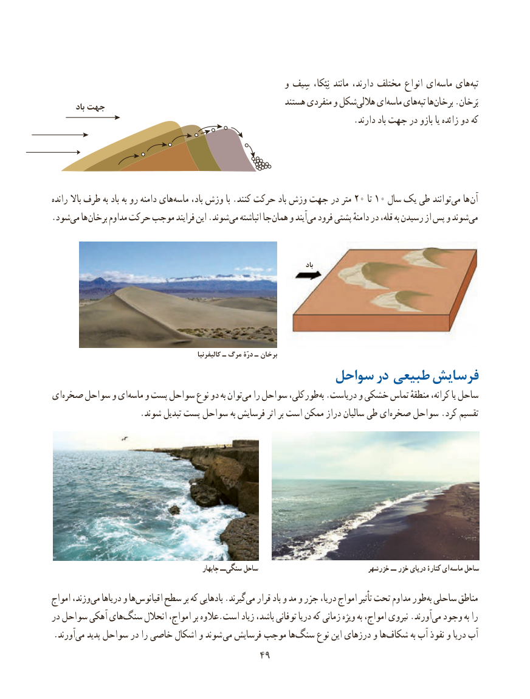

# PDF page 57

و سِیف  نِبْکا، مانند دارند، مختلف انواع ای ‌ماسه های ‌تپه
                                                        هستند منفردی و شکلهاللی‌    ایماسه‌   هایتپه‌  هابرخان‌    .بَرخان        باد جهت
                                                                       .دارند باد جهت در بازو یا زائده دو که

رانده باال طرف به باد به رو دامنه هایماسه‌     باد، وزش با .کنند حرکت باد وزش جهت در متر 20 تا 10 سال یک طی توانند ‌می ها آن
.‌شودمی ها برخان مداوم حرکت موجب فرایند این .شوندمی‌   انباشته جا همان و آیندمی‌  فرود پشتی دامنهٔ در قله، به رسیدن از پس و شوندمی‌

                                                                                                       باد

                                                        کالیفرنیا ـ مرگ درّۀ ـ برخان
                                    سواحل در طبیعی فرسایش
ای‌صخره سواحل و ایماسه‌    و پست سواحل نوع دو به توانمی‌   را سواحل طورکلی،به‌ .دریاست و خشکی تماس منطقهٔ کرانه، یا ساحل
 .‌شوند تبدیل پست سواحل به فرسایش اثر بر است ممکن دراز سالیان طی ایصخره سواحل .کرد تقسیم

                                                       چابهار ــ سنگی ساحل                               خزرشهر ــ خزر دریای کنارۀ ای ماسه ساحل

امواج وزند،می‌   دریاها و ها‌اقیانوس سطح بر که بادهایی .گیرندمی‌   قرار باد و مد و جزر دریا، امواج تأثیر تحت مداوم طور ‌به ساحلی مناطق
در سواحل آهکی های‌سنگ انحالل امواج، بر عالوه.است زیاد باشد، توفانی دریا که زمانی ویژه به امواج، نیروی .آورند ‌می وجود به را
.آورند ‌می پدید سواحل در را خاصی اشکال و شوند می فرسایش موجب هاسنگ‌     نوع این درزهای و هاشکاف‌        به آب نفوذ و دریا آب
                                      4949

