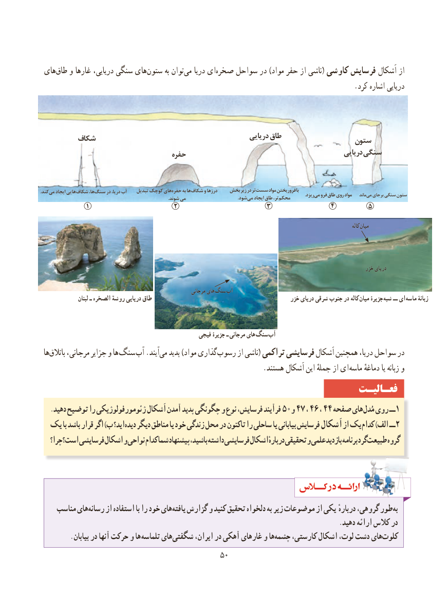

# PDF page 58

های‌طاق و غارها دریایی، سنگی هایستون‌       به توانمی‌   دریا ای‌صخره سواحل در )مواد حفر از ناشی( کاوشی فرسایش اَشکال از
                                                                                       .کرد اشاره دریایی

                                                                دریایی طاق                    ‌شکاف                                                             ستون
                                                                                               دریایی سنگی                                                                     ‌حفره

.کندمی‌   ایجاد هایی شکاف ها،سنگ‌     در دریا، آب    تبدیل کوچک هایحفره‌     به هاشکاف‌     و درزها   بخش زیر در تر سست مواد فروریختن با                                                                                                                                                                                                                                 .ریزدمی‌  فرو طاق روی مواد    ماندمی‌  برجای سنگی ستون                                                                                                             .شوند می                                            .شودمی‌   ایجاد طاق تر،محکم‌
                 ١                       ٢                     ٣               ٤        ٥

                                                                                                                                                                       کاله میان

                                                                                                                           خزر دریای

                                                                مرجانی های سنگ آب
                   لبنان ـ الصخره روشة دریایی طاق                                               خزر دریای شرقی جنوب در کاله میان جزیرۀ شبه ــ ای ماسه زبانۀ

                                                    فیجی جزیرۀ ـ مرجانی های سنگ آب
 ها‌باتالق مرجانی، جزایر و ها سنگ آب .آیندمی‌   پدید )مواد گذاری‌رسوب از ناشی( تراکمی فرسایشی اَشکال همچنین دریا، سواحل در
     . هستند اَشکال این جملهٔ از ای ماسه دماغهٔ یا زبانه و
                                                                 فعـالیـت
   .دهید توضیح را ژئومورفولوژیکی اَشکال آمدن پدید چگونگی و نوع فرسایش، فرآیند 50و 47 ، 46 ، 44 صفحه های مُدل روی ــ 1
  یک با باشد قرار اگر )ب اید؟ دیده دیگر مناطق یا خود زندگی محل در تاکنون را ساحلی یا بیابانی فرسایش اَشکال از یک کدام )الف ــ 2
   چرا؟ است؟ فرسایشی اشکال و نواحی کدام شما پیشنهاد باشید، داشته فرسایشی اشکال دربارهٔ تحقیقی و علمی بازدید برنامه گرد طبیعت گروه

    مناسب هایرسانه‌     از استفاده با را خود هاییافته‌   گزارش و کنید تحقیق دلخواه به زیر موضوعات از یکی دربارهٔ گروهی، طوربه‌
                                                                                          .دهید ارائه کالس در
 . بیابان در آنها حرکت و ها تلماسه هایشگفتی‌       ایران، در آهکی غارهای و هاچشمه‌    کارستی، اشکال لوت، دشت هایکلوت‌
                                           5050

