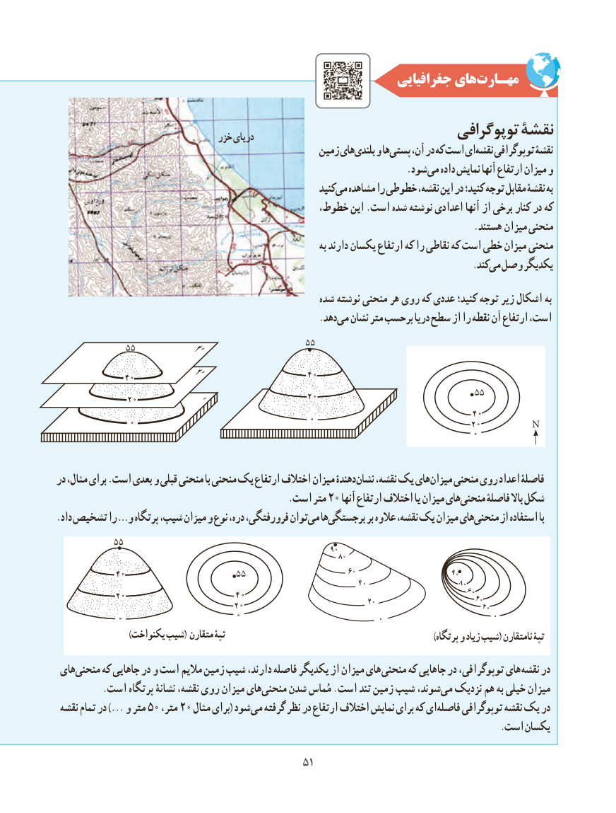

# PDF page 59

جغرافیایی هایمهـارت‌

                                  خزرخزر دریایدریای                             توپوگرافی نقشة
                                                    زمین هایبلندی‌   و هاپستی‌    آن، در که است اینقشه‌    توپوگرافی نقشۀ
                              .‌شودمی داده نمایش آنها ارتفاع میزان و
                                                               کنیدمی‌  مشاهده را خطوطی نقشه، این در کنید؛ توجه مقابل نقشۀ به
                                             خطوط، این .است شده نوشته اعدادی آنها از برخی کنار در که
                                                                                           .هستند میزان منحنی
                                                                        به دارند یکسان ارتفاع که را نقاطی که است خطی میزان منحنی
                                           .‌کندمی وصل یکدیگر
                                                    شده نوشته منحنی هر روی که عددی کنید؛ توجه زیر اشکال به
                          .‌دهدمی نشان متر برحسب دریا سطح از را نقطه آن ارتفاع است،

                                                               N

در مثال، برای .است بعدی و قبلی منحنی با منحنی یک ارتفاع اختالف میزان دهندۀ نشان نقشه، یک هایمیزان‌    منحنی روی اعداد فاصلۀ
                                                   .است متر 20 آنها ارتفاع اختالف یا میزان هایمنحنی‌     فاصلۀ باال شکل
.‌داد تشخیص را …و پرتگاه شیب، میزان و نوع ،دره‌  فرورفتگی، توانمی‌   هابرجستگی‌          بر عالوه نقشه، یک میزان هایمنحنی‌     از استفاده با

                                                                    90
                                                                      80
                                                                        60
                                                                          40
                                                                             20
                                                                                0
                         ))یکنواختیکنواخت شیبشیب(( متقارنمتقارن تپۀتپۀ                                                                        ))پرتگاهپرتگاه وو زیادزیاد شیبشیب(( نامتقارننامتقارن تپۀتپۀ
 هایمنحنی‌     که جاهایی در و است مالیم زمین شیب دارند، فاصله یکدیگر از میزان های منحنی که جاهایی در توپوگرافی، های نقشه در
          .است پرتگاه نشانۀ نقشه، روی میزان هایمنحنی‌    شدن مُماس .است تند زمین شیب شوند،می‌  نزدیک هم به خیلی میزان
 نقشه تمام در ...) و متر 50 ،متر 20 مثال برای( شود می گرفته نظر در ارتفاع اختالف نمایش برای که ای فاصله توپوگرافی نقشه یک در
                                                                                                 .است یکسان

                                            5151

