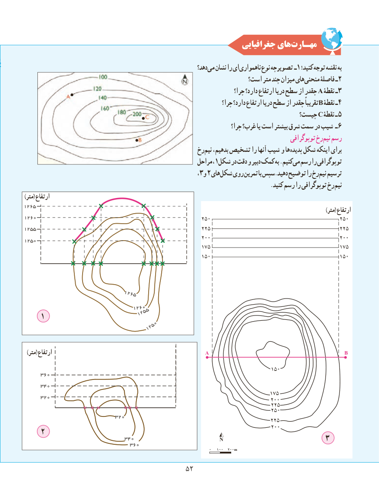

# PDF page 60

جغرافیایی هایمهـارت‌

                                                                   دهد؟می‌  نشان را ای ناهمواری نوع تصویرچه ـ 1 کنید؛ توجه نقشه به
                                                                 است؟ متر چند میزان هایمنحنی‌     فاصلۀ ـ2
                                                                               چرا؟ دارد؟ ارتفاع دریا سطح از چقدر A نقطۀ ـ3
                                                                           چرا؟ دارد؟ ارتفاع دریا سطح از چقدر تقریباً B نقطۀ ـ4
                                                                              چیست؟ C نقطۀ ـ 5
                                                                              چرا؟ غرب؟ یا است بیشتر شرق سمت در شیب ـ 6
                                                                                                توپوگرافی رخنیم‌  رسم
                                                 رخنیم‌   بدهیم، تشخیص را آنها شیب و ها پدیده شکل اینکه برای
                                                          مراحل ،1شکل در دقت و دبیر کمک به .کنیممی‌  رسم را توپوگرافی
                                                                            ،3و 2 های شکل روی تمرین با سپس.دهید توضیح را رخنیم‌  ترسیم
        . کنید رسم را توپوگرافی رخنیم
))مترمتر(( ارتفاعارتفاع
1265                                                                                                                                                                  ))مترمتر(( ارتفاعارتفاع
1260
1255
1250

                             1265
                                 1260                               1255    1
                                 1250

  ))مترمتر(( ارتفاعارتفاع

     360
     340
     320

                             320
    2                                340                                                                       3                                 360

                                        5252

