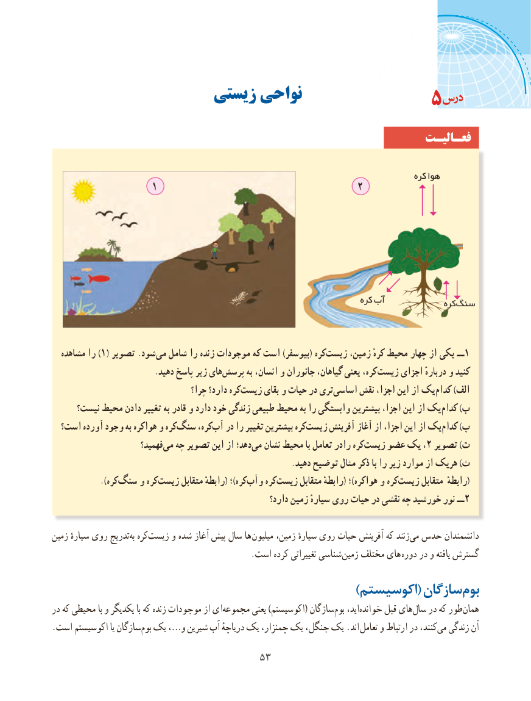

# PDF page 61

زیستی نواحی                                   5
                                                                 فعـالیـت

                                                                                        کره هوا
                 1                                 2

                                                                           کره آب                                                                                                 کره سنگ

  مشاهده را )1( تصویر .شود‌می شامل را زنده موجودات که است )بیوسفر( کره ‌زیست زمین، کرهٔ محیط چهار از یکی ــ 1
                          .دهید پاسخ زیر های ‌پرسش به انسان، و جانوران گیاهان، یعنی کره، زیست اجزای دربارهٔ و کنید
                                    چرا؟ دارد؟ کره‌زیست بقای و حیات در تری‌اساسی نقش اجزا، این از یک‌کدام )الف
      نیست؟ محیط دادن تغییر به قادر و دارد خود زندگی طبیعی محیط به را وابستگی بیشترین اجزا، این از یک ‌کدام )ب
  است؟ آورده وجود به هواکره و کره‌سنگ کره،‌آب در را تغییر بیشترین کره‌زیست آفرینش آغاز از اجزا، این از یک ‌کدام )پ
                        فهمید؟می‌  چه تصویر این از دهد؛‌می نشان محیط با تعامل رادر کره ‌زیست عضو یک ، 2 تصویر )ت
                                                             .دهید توضیح مثال ذکر با را زیر موارد از هریک )ث
       ).‌کرهسنگ و کرهزیست‌      متقابل رابطهٔ( ؛)کرهوآب‌    کرهزیست‌      متقابل رابطهٔ( ؛)هواکره و کرهزیست‌(متقابل رابطهٔ
                                                           دارد؟ زمین سیارهٔ روی حیات در نقشی چه خورشید نور ــ2

زمین سیارهٔ روی تدریجبه‌  کره‌زیست و شده آغاز پیش سال ها میلیون زمین، سیارهٔ روی حیات آفرینش که زنند‌می حدس دانشمندان
    . است کرده تغییراتی شناسی زمین مختلف های دوره در و یافته گسترش
     )‌اکوسیستم( سازگانبوم
در که محیطی با و یکدیگر با که زنده موجودات از ای‌مجموعه یعنی )اکوسیستم( سازگانبوم‌   اید،خوانده‌      قبل های‌سال در که طور‌همان
.‌است اکوسیستم یا سازگانبوم یک ،…و شیرین آب دریاچهٔ یک چمنزار، یک جنگل، یک .اند تعامل و ارتباط در کنند،می‌  زندگی آن

                                  5353

