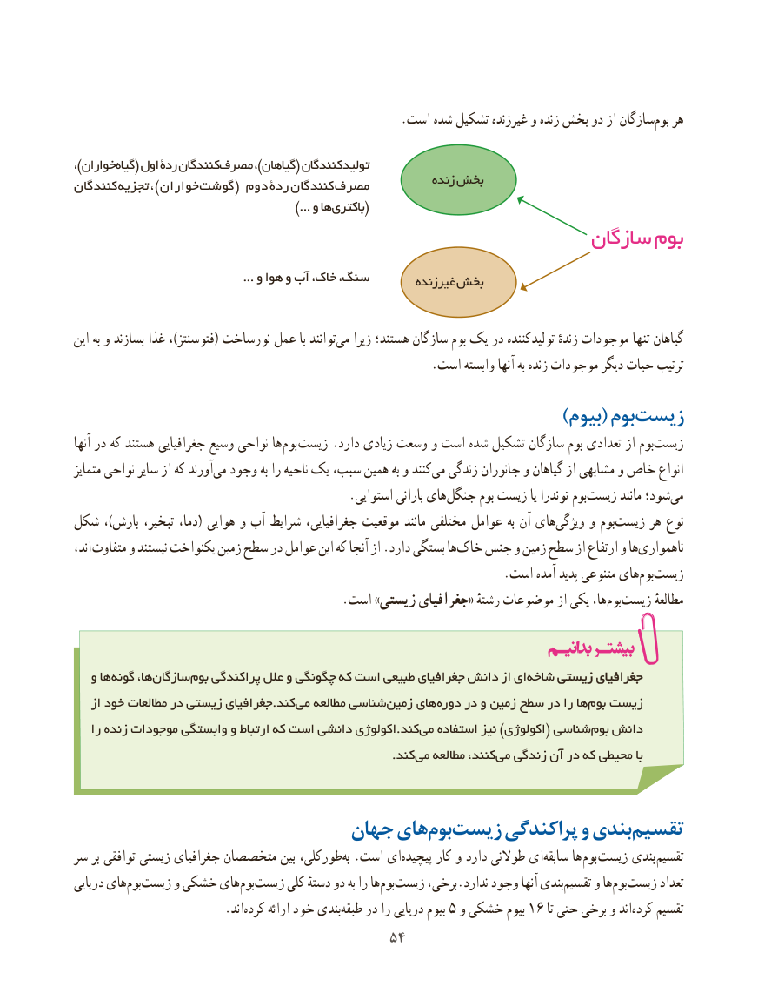

# PDF page 62

.است شده تشکیل غیرزنده و زنده بخش دو از سازگانبوم‌   هر

،)خوارانگیاه‌   ( اول ردة کنندگانمصرف‌         ،)گیاهان( تولیدکنندگان
                                                              زنده بخشکنندگان‌تجزیه  ، ) خواران ‌گوشت ( دوم  ردة  کنندگان‌مصرف
                  ...)‌(و هاباکتری
                                                   سازگان بوم
                                              ... و هوا و آب خاک، سنگ،                                                           غیرزنده بخش

این به و بسازند غذا ،)فتوسنتز( نورساخت عمل با توانندمی‌   زیرا هستند؛ سازگان بوم یک در تولیدکننده زندهٔ موجودات تنها گیاهان
                                                           .است وابسته آنها به زنده موجودات دیگر حیات ترتیب
            )‌بیوم( بومزیست
آنها در که هستند جغرافیایی وسیع نواحی ها بوم زیست .دارد زیادی وسعت و است شده تشکیل سازگان بوم تعدادی از بومزیست‌
متمایز نواحی سایر از که آورند‌می وجود به را ناحیه یک سبب، همین به و کنندمی‌  زندگی جانوران و گیاهان از مشابهی و خاص انواع
     .‌استوایی بارانی های جنگل بوم زیست یا توندرا بومزیست‌       مانند شود؛می‌
شکل ، ) بارش تبخیر، دما، ( هوایی و آب شرایط جغرافیایی، موقعیت مانند مختلفی عوامل به آن های‌ویژگی و بوم ‌زیست هر نوع
اند، متفاوت و نیستند یکنواخت زمین سطح در عوامل این که آنجا از .دارد بستگی هاخاک‌   جنس و زمین سطح از ارتفاع و هاناهمواری‌
                                                                       .است آمده پدید متنوعی هایبوم‌    ‌زیست
  .‌است »زیستی جغرافیای« رشتهٔ موضوعات از یکی ها،بوم‌زیست مطالعهٔ

   و هاگونه‌     ها،سازگان‌      بوم‌   پراکندگی علل و چگونگی که است طبیعی جغرافیای دانش از ایشاخه‌    زیستیزیستی جغرافیایجغرافیای
   از خود مطالعات در زیستی جغرافیای.کندمی‌   مطالعه شناسیزمین‌    هایدوره‌    در و زمین سطح در را هابوم‌  زیست‌
   را زنده موجودات وابستگی و ارتباط که است دانشی اکولوژی.کندمی‌  استفاده نیز )اکولوژی( شناسیبوم‌  دانش
                        .‌کندمی مطالعه کنند،می‌  زندگی آن در که محیطی با

                         جهان هایبوم‏ زیست‏     پراکندگی و بندیتقسیم‏
سر بر توافقی زیستی جغرافیای متخصصان بین طورکلی، ‌به .است ای‌پیچیده کار و دارد طوالنی ای‌سابقه ها بوم زیست بندی تقسیم
دریایی های‏بوم ‏زیست و خشکی های‏بوم‏زیست کلی دستهٔ دو به را هابوم‏    ‏زیست برخی،.ندارد وجود آنها بندی‏تقسیم و هابوم‏    ‏زیست تعداد
              .‏اندکرده ارائه خود بندی‏طبقه در را دریایی بیوم 5 و خشکی بیوم 16 تا حتی برخی و اندکرده‏    تقسیم
                                       5454

