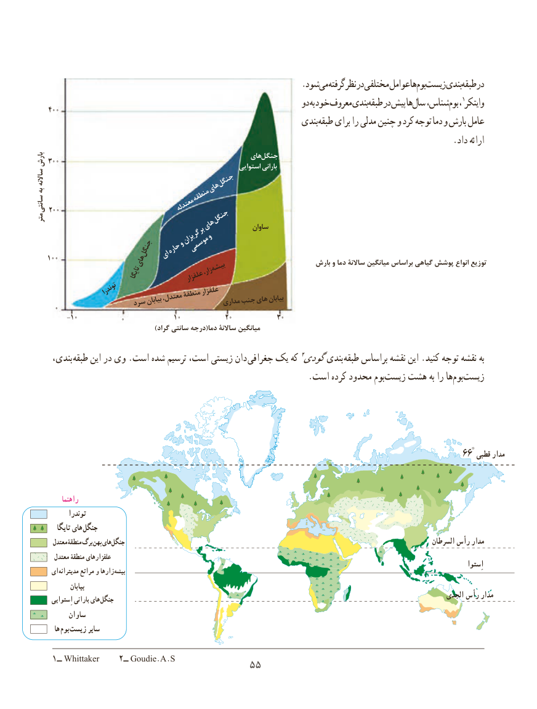

# PDF page 63

.شودمی‏  گرفتهنظردرمختلفیعواملهابوم‏ زیست‏    بندیطبقه‏   در
                                                                     دو به خود معروف بندیطبقه‏   در پیش هاسال‏  شناس،بوم   ، 1وایتکر    400400
                                                                 بندیطبقه‏    برای را مدلی چنین و کرد توجه دما و بارش عامل
                                                                                                  .داد ارائه
                                                           هایجنگل بارش 300300                                                                 استوایی بارانی
ساالنه                     جنگلبه                            های                                   منطقهسانتی     200200                             معتدلهمتر                  جنگل                            های           ساوانساوان
                و             وبرگریزان                              موسمی        جنگل  حاره                  ای    100100            های                                             بارش و دما ساالنة میانگین براساس گیاهی پوشش‏       انواع توزیع                          بیشه                         تایگا                 زار،                                          علفزار
                  توندرا                         علفزار                                      منطقۀ                                   معتدل،                                                    مداریجنبهایبیابان                     سردبیابان      0
         -1010           0             1010            2020            3030
                                             )گراد سانتی درجه(دما ساالنة میانگین

     بندی، طبقه این در وی .است شده ترسیم است، زیستی دان  جغرافی٢بندییک که گودی       طبقه براساس نقشه این .کنید توجه نقشه به
       .‏است کرده محدود بومزیست هشت به را هابوم‏    ‏زیست

                                                                                                      66° قطبی مدار

          راهنما
            توندرا
         تایگا های جنگل
       معتدل منطقۀ برگ پهن های جنگل                                                                                               السرطان  رأس مدار
       معتدل منطقۀ علفزارهای
                                                                                                                                                                  اِستوا     ای مدیترانه مراتع و زارها بیشه
               بیابان
                                                                                                                       الجدی   رأس مدار       اِستوایی بارانی های جنگل
          ساوان
        ها بوم  زیست سایر

    ١ــ Whittaker    ٢ــ Goudie.A.S                                    5555

