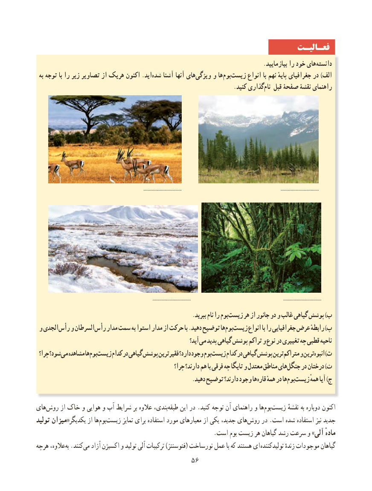

# PDF page 64

فعـالیـت
                                                                                  .بیازمایید را خود های ‏دانسته
 به توجه با را زیر تصاویر از هریک اکنون .اید ‏شده آشنا آنها های‏ویژگی و ها‏بوم‏زیست انواع با نهم پایهٔ جغرافیای در )الف
            .‌کنید گذارینام قبل صفحۀ نقشۀ راهنمای

                                                                                            .................................                                                                                      .................................

                                                                                                    .................................                                                                                .................................
        .‏ببرید نام را بومزیست هر از جانور دو و غالب گیاهی پوشش )ب
 و الجدی رأس و السرطان رأس مدار سمت به استوا مدار از حرکت با .دهید توضیح هابوم‏  زیست‏     انواع با را جغرافیایی عرض رابطهٔ )پ
                                                                آید؟ می پدید گیاهی پوشش تراکم و نوع در تغییری چه قطبی ناحیه
 چرا؟ شود؟می‏  مشاهده هابوم‏  زیست‏     کدام در گیاهی پوشش فقیرترین دارد؟ وجود بومزیست‏     کدام در گیاهی پوشش ترینمتراکم‏    و ترینانبوه‏     )ت
                                                     چرا؟ دارند؟ هم با فرقی چه تایگا و معتدل مناطق هایجنگل‏    در درختان )ث
     . دهید توضیح دارند؟ وجود هاقاره همهٔ در هابوم‏  زیست‏      همهٔ آیا )ج

های‏روش از خاک و هوایی و آب شرایط بر عالوه بندی،‏طبقه این در .کنید توجه آن راهنمای و ها ‏بوم ‏زیست نقشهٔ به دوباره اکنون
تولید میزان«یکدیگر از ها ‏بوم‏زیست تمایز برای استفاده مورد معیارهای از یکی جدید، هایروش‏    در .است شده استفاده نیز جدید
                                                           .است بوم زیست هر گیاهان رشد سرعت و »آلی مادهٔ
هرچه عالوه،‌به .کنند‏می آزاد اکسیژن و تولید آلی ترکیبات )فتوسنتز( نورساخت عمل با که هستند ای  تولیدکننده زندهٔ موجودات گیاهان
                                       5656

