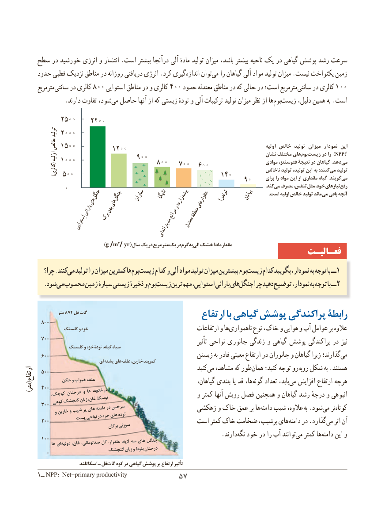

# PDF page 65

سطح در خورشید انرژی و انتشار .است بیشتر درآنجا آلی مادهٔ تولید میزان باشد، بیشتر ناحیه یک در گیاهی پوشش رشد سرعت
    حدود قطبی نزدیک مناطق در روزانه دریافتی انرژی .کرد گیری‏اندازه توان‏می را گیاهان آلی مواد تولید میزان .نیست یکنواخت زمین
      مترمربعسانتی‏    در کالری 800 استوایی مناطق در و کالری 400 حدود معتدله مناطق در که حالی در است؛ مترمربع‏سانتی در کالری 100
              .دارند تفاوت شود،می‏  حاصل آنها از که زیستی تودهٔ و آلی ترکیبات تولید میزان نظر از هابوم‏    ‏زیست دلیل، همین به .است
          2500    2٢ 00
            تولید 2000
         خالص 1500                        ١٢ 00                                                                   اولیه خالص تولید میزان نمودار این                                                                                           نشان مختلف های‏بوم‌)زیست در را  NPP(1              اوّلیه  (                     900          1000                                                                              موادی فتوسنتز، نتیجة در گیاهان .دهد‏می                                    800   700  600            کالری)                                                                                      ناخالص تولید تولید، این به کنند؛می‏   تولید           500                                       140               برای را مواد این از مقداری گیاه .گویندمی‏                                                           90
           0                                                                                                                                                                    .کندمی‏  مصرف تنفس، مثل خود، نیازهای رفع        جنگل  جنگل  ساوان   تایگا                  بیشه         توندرا    بیابان .‏است اولیه خالص تولید ماندمی باقی آنچه                های  های                                                         زارها    علفزارهای               و                     پهن                         بارانی                                                     مراتع   منطقۀ                   برگ                         اِستوایی                                  معتدل                مدیترانه                        ای
                                )g /m2/ yr( سال یک در مربع متر یک در گرم به آلی خشک مادۀ مقدار
                                                                    فعـالیـت
        چرا؟ .کنند می تولید را میزان کمترین ها بوم زیست کدام و آلی مواد تولید میزان بیشترین بوم زیست کدام بگویید نمودار، به توجه با ــ1
        .شود می محسوب زمین سیارهٔ زیستی ذخیرهٔ و بومزیست‏     ترینمهم‏   استوایی، بارانی هایجنگل‏    چرا دهید توضیح نمودار، به توجه با ــ2

                  متر 874 فل گات                                             ارتفاع با گیاهی پوشش پراکندگی رابطۀ       800
              گلسنگ و خزه                                                                 ارتفاعات و هاناهمواری‏        نوع خاک، و هوایی و آب عوامل بر عالوه
       700                                                                            تأثیر نواحی جانوری زندگی و گیاهی پوشش پراکندگی در نیز                گلسنگ و خزه تودۀ گیله، سیاه
       600                                               زیستن به قادر معینی ارتفاع در جانوران و گیاهان زیرا گذارند؛می‏                                  ای پشته های علف خاربن، کمربند
       500                                                          کنیدمی‏  مشاهده که طور ‏همان کنید؛ توجه رو ‏روبه شکل به .هستندارتفاعارتفاع
             جگن و خیزاب علف                                        گیاهان، بلندی یا قد ها،گونه‏    تعداد یابد، ‏می افزایش ارتفاع هرچه((مترمتر))  400          کوچک، درختان و ها درختچه                                                         و کمتر آنها رویش فصل همچنین و گیاهان رشد درجهٔ و انبوهی           کوهیگنجشکزبانغان،توسکا،       300           و خاربن و شیب پر های دامنه در سرخس                   زهکشی و خاک عمق بر هادامنه‏   شیب عالوه، به .شود‏می تر‏کوتاه               پستنواحیدرخزههایتوده       200                                            است کمتر خاک ضخامت پرشیب، هایدامنه‏    در .گذاردمی‏   اثر آن                                         برگانسوزنی
                       .‏دارندنگه خود در را آب توانندمی‏   کمتر هادامنه‏     این و       100                ها، ای دولپه غان، صدتومانی، گل علفزار، :الیه سه های جنگل
                          گنجشک زبان و بلوط درختان         0
                         اسکاتلند ـ فلگات‌   کوه در گیاهی پوشش بر ارتفاع تأثیر
     ١ــ NPP: Net-primary productivity            5757

