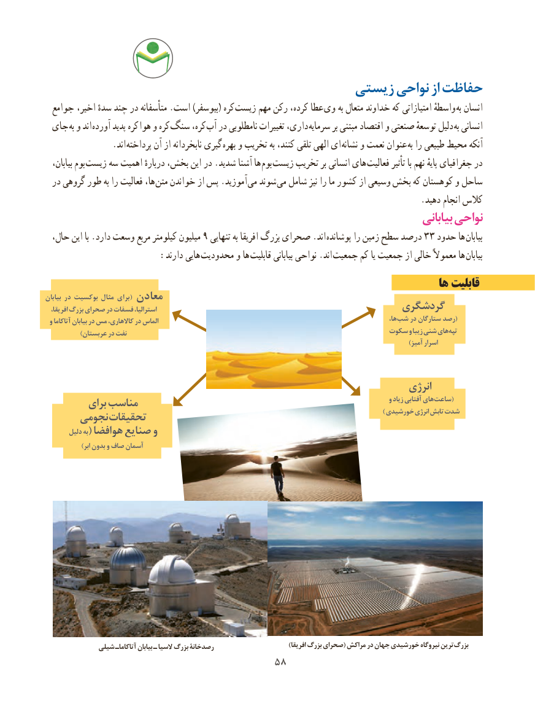

# PDF page 66

زیستی نواحی از حفاظت
  جوامع  ،کرهاخیر سدهٔ چند در متأسفانه .است )بیوسفر(       زیست مهم رکن کرده، عطا  وی به متعال خداوند که امتیازاتی واسطهٔ به انسان
 جای به و اند آورده پدید کره  هوا و کره سنگ کره، آب در نامطلوبی تغییرات داری، سرمایه بر مبتنی اقتصاد و صنعتی توسعهٔ دلیل به انسانی
                .اند پرداخته آن از نابخردانه گیری بهره و تخریب به کنند، تلقی الهی ای نشانه و نعمت عنوان به را طبیعی محیط آنکه
   بیابان، بوم  زیست سه اهمیت دربارهٔ بخش، این در .شدید آشنا ها بوم زیست تخریب بر انسانی های فعالیت تأثیر با نهم پایهٔ جغرافیای در
  در گروهی طور به را فعالیت ها، متن خواندن از پس .آموزید  می شوند  می شامل نیز را ما کشور از وسیعی بخش که کوهستان و ساحل
                                                                                        .دهید انجام کالس
                                                                                      بیابانی نواحی
  حال، این با .دارد وسعت مربع کیلومتر میلیون 9 تنهایی به افریقا بزرگ صحرای .اند  پوشانده را زمین سطح درصد 33 حدود ها بیابان
                     :دارند هایی محدودیت و ها قابلیت بیابانی نواحی .اند جمعیت کم یا جمعیت از خالی معموالً ها  بیابان
                                                                                ها قابلیت
بیابان در بوکسیت مثال برای ( معادن  افریقا، بزرگ صحرای در فسفات استرالیا،                                        گردشگری
 و آتاکاما بیابان در مس کاالهاری، در الماس                                                                                          ها، (شب در ستارگان رصد
             )عربستان در نفت                                                       سکوت و زیبا شنی های تپه
                                                                                                                                      )آمیز اسرار

                                                                              انرژی
         برای مناسب                                                                               و زیاد آفتابی های (ساعت
      نجومی تحقیقات                                                                                       ) خورشیدی انرژی تابش شدت
       دلیل به( هوافضا صنایع و
             )ابر بدون و صاف آسمان

             شیلی آتاکاماـ بیابان ـ السیا بزرگ رصدخانۀ                           )افریقا بزرگ صحرای( مراکش در جهان خورشیدی نیروگاه ترین بزرگ
                                      5858

