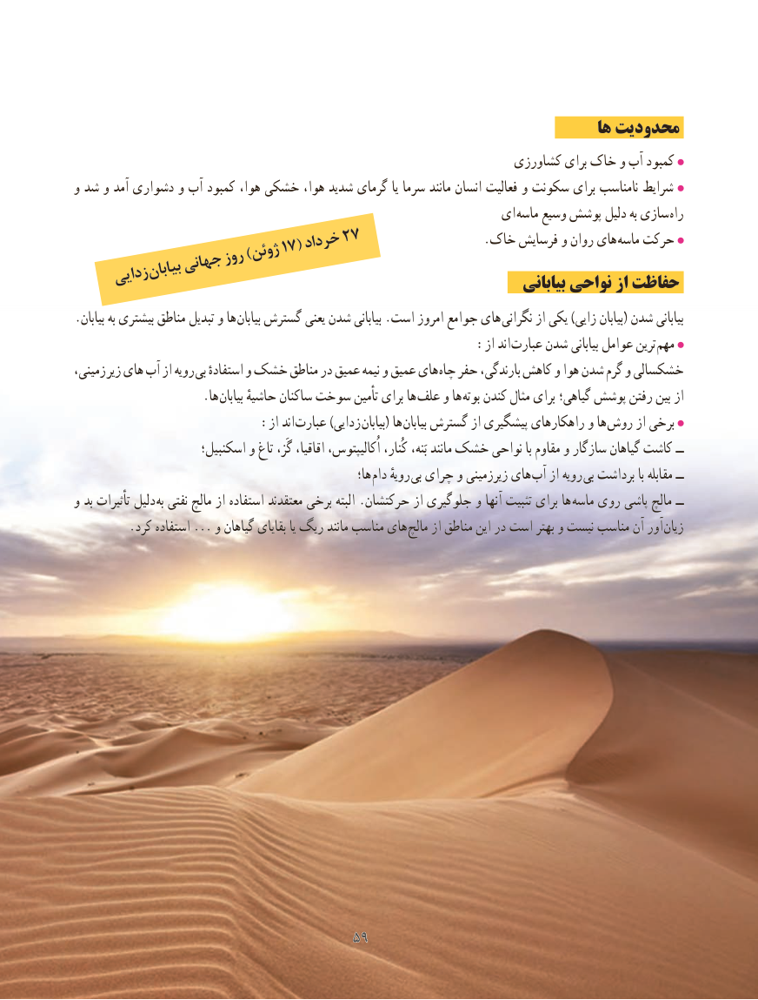

# PDF page 67

ها محدودیت
                                                                 کشاورزی برای خاک و آب کمبود
و شد و آمد دشواری و آب کمبود هوا، خشکی هوا، شدید گرمای یا سرما مانند انسان فعالیت و سکونت برای نامناسب شرایط
                                                            ای ماسه وسیع پوشش دلیل به سازی راه
                           خرداد27                        17(                              .خاک فرسایش و روان های ماسه حرکت                     ژوئن                  روز)            جهانی        بیابان     زدایی                                                                         بیابانی نواحی از حفاظت
.بیابان به بیشتری مناطق تبدیل و ها بیابان گسترش یعنی شدن بیابانی .است امروز جوامع های نگرانی از یکی )زایی بیابان( شدن بیابانی
                                                     :از اند عبارت شدن بیابانی عوامل ترین مهم
،زمینی زیر های آب از رویه بی استفادهٔ و خشک مناطق در عمیق نیمه و عمیق های چاه حفر بارندگی، کاهش و هوا شدن گرم و خشکسالی
                     .ها  بیابان حاشیهٔ ساکنان سوخت تأمین برای ها علف و ها بوته کندن مثال برای گیاهی؛ پوشش رفتن بین از
          : از اند عبارت )زدایی بیابان( ها بیابان گسترش از پیشگیری راهکارهای و ها روش از برخی
                       اسکنبیل؛ و تاغ گَز، اقاقیا، اُکالیپتوس، کُنار، بَنه، مانند خشک نواحی با مقاوم و سازگار گیاهان کاشت ــ
                                                            ها؛ دام رویهٔ بی چرای و زیرزمینی های آب از رویه بی برداشت با مقابله ــ
و بد تأثیرات دلیل به نفتی مالچ از استفاده معتقدند برخی البته .حرکتشان از جلوگیری و آنها تثبیت برای ها ماسه روی پاشی مالچ ــ
. کرد استفاده ... و گیاهان بقایای یا ریگ مانند مناسب های مالچ از مناطق این در است بهتر و نیست مناسب آن آور زیان

                                   5959

