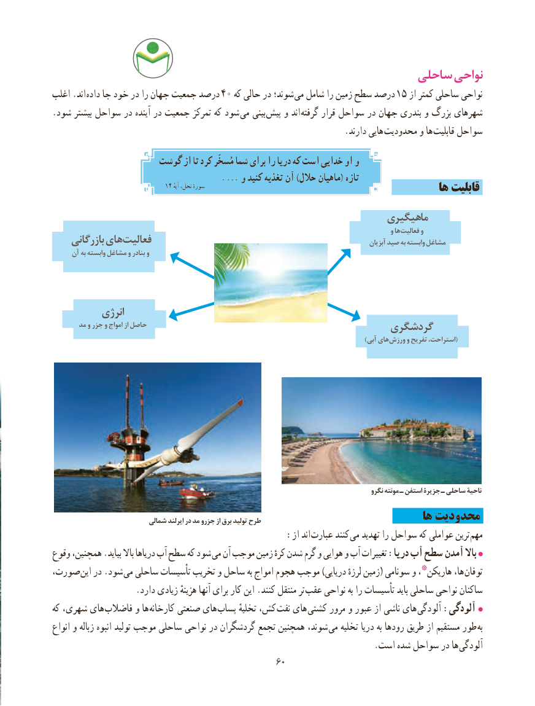

# PDF page 68

ساحلی نواحی
اغلب .اند داده جا خود در را جهان جمعیت درصد  40 که حالی در شوند؛ می شامل را زمین سطح درصد  15 از کمتر ساحلی نواحی
.شود بیشتر سواحل در آینده در جمعیت تمرکز که شود  می بینی  پیش و اند گرفته قرار سواحل در جهان بندری و بزرگ شهرهای
                                                                    .دارند هایی  محدودیت و ها قابلیت سواحل
                   گوشت از تا کرد مُسخّر شما برای را دریا که است خدایی او و
                                                  . ... و کنید تغذیه آن )حالل ماهیان( تازه                                14 آیهسورهٔنحل،                                                                              ها قابلیت
                                                                ماهیگیری
                                                                                                           و ها فعالیت و
    بازرگانی های فعالیت                                                                              آبزیان صید به وابسته مشاغل
     آن به وابسته مشاغل و بنادر و

           انرژی
       مد و جزر و امواج از حاصل                                                       گردشگری
                        ) آبی هایورزش و تفریح استراحت،(

                                                                                                      نگرو مونته ـ استفن جزیرۀ ـ ساحلی ناحیۀ
                           شمالی ایرلند در مد جزرو از برق تولید طرح                                 ها محدودیت
                                           :از اند عبارت کنند می تهدید را سواحل که عواملی ترین مهم
وقوع همچنین، .بیاید باال دریاها آب سطح که شود می آن موجب زمین کرهٔ شدن گرم و هوایی و آب تغییرات :دریا آب سطح آمدن باال
،صورت این در .شود  می ساحلی تأسیسات تخریب و ساحل به امواج هجوم موجب )دریایی لرزهٔ زمین( سونامی و هاریکن٭، ها، توفان
                   .دارد زیادی هزینهٔ آنها برای کار این .کنند منتقل تر عقب نواحی به را تأسیسات باید ساحلی نواحی ساکنان
که شهری، های فاضالب و ها  کارخانه صنعتی های  پساب تخلیهٔ کش، نفت های کشتی مرور و عبور از ناشی های آلودگی :آلودگی
انواع و زباله انبوه تولید موجب ساحلی نواحی در گردشگران تجمع همچنین شوند، می تخلیه دریا به رودها طریق از مستقیم طور  به
       . است شده سواحل در ها آلودگی
                                                6060

