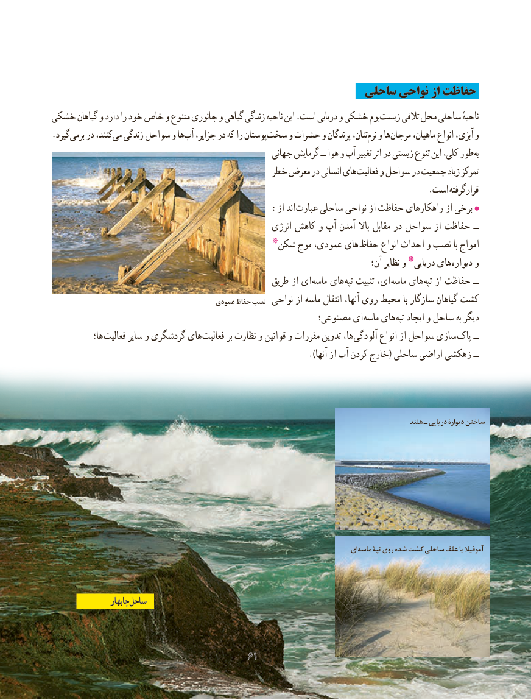

# PDF page 69

ساحلی نواحی از حفاظت
خشکی گیاهان و دارد را خود خاص و متنوع جانوری و گیاهی زندگی ناحیه این .است دریایی و خشکی بوم زیست تالقی محل ساحلی ناحیهٔ
.گیرد برمی در کنند، می زندگی سواحل و ها آب جزایر، در که را پوستان سخت و حشرات و پرندگان تنان، نرم و ها مرجان ماهیان، انواع آبزی، و
                                                     جهانی گرمایش ــ هوا و آب تغییر اثر در زیستی تنوع این کلی، طور به
                                           خطر معرض در انسانی های فعالیت و سواحل در جمعیت زیاد تمرکز
                   . است گرفتهقرار
                 : از اند عبارت ساحلی نواحی از حفاظت راهکارهای از برخی
                                                       انرژی کاهش و آب آمدن باال مقابل در سواحل از حفاظت ــ
                                      شکن٭ موج عمودی، های حفاظ انواع احداث و نصب با امواج
                                                                                       آن؛ نظایر و دریایی٭ های دیواره و
                                                    طریق از ای ماسه های تپه تثبیت ای، ماسه های تپه از حفاظت ــ
                                          عمودی حفاظ نصب  نواحی از ماسه انتقال آنها، روی محیط با سازگار گیاهان کشت
                                                        مصنوعی؛ ای  ماسه های تپه ایجاد و ساحل به دیگر
            ها؛ فعالیت سایر و گردشگری های فعالیت بر نظارت و قوانین و مقررات تدوین ها،  آلودگی انواع از سواحل سازی پاک ــ
                                                                        ).آنها از آب کردن خارج( ساحلی اراضی زهکشی ــ

                                                                                                          هلند ـ دریایی دیوارۀ ساختن

                                                                                      ای ماسه تپۀ روی شده کشت ساحلی علف یا آموفیال

                  چابهارچابهار ساحلساحل

                                           6161

