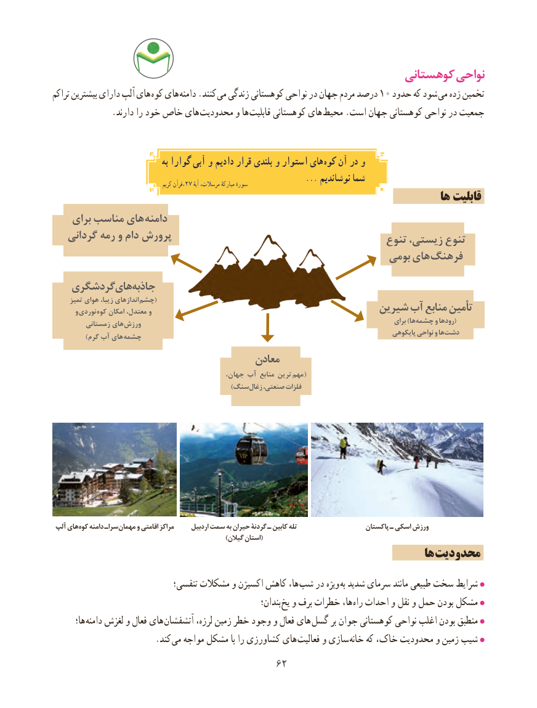

# PDF page 70

کوهستانی نواحی
تراکم بیشترین دارای آلپ های کوه های دامنه .کنند می زندگی کوهستانی نواحی در جهان مردم درصد 10 حدود که شود می زده تخمین
 . دارند را خود خاص های محدودیت و ها قابلیت کوهستانی های  محیط .است جهان کوهستانی نواحی در جمعیت

                                  به گوارا آبی و دادیم قرار بلندی و استوار های کوه آن در و
                                                               ... نوشاندیم شما                                               کریم ،قرآن27 آیهٔسورهٔمرسالت، مبارکهٔ
                                                                              ها قابلیت
    برای مناسب های دامنه
   گردانی رمه و دام پرورش                                                               تنوع زیستی، تنوع
                                                               بومی های فرهنگ
   گردشگری های جاذبه
      تمیز هوای زیبا، اندازهای  (چشم
             و نوردی کوه امکان معتدل، و                                      شیرین آب منابع تأمین
                                                                                                                 برای )ها چشمه و رودها(         زمستانی های  ورزش
                                                                                                    پایکوهی نواحی و ها دشت            )گرم آب های چشمه
                                        معادن
                                                جهان، آب منابع ترین  (مهم
                  ) سنگزغال صنعتی، فلزات

 آلپ های کوه دامنه سراـ مهمان و اقامتی مراکز      اردبیل سمت به حیران گردنۀ ـ کابین تله                    پاکستان ـ اسکی ورزش
                                                               )گیالن استان(
                                                                           ها محدودیت
                              تنفسی؛ مشکالت و اکسیژن کاهش ها، شب در ویژه به شدید سرمای مانند طبیعی سخت شرایط
                                                             بندان؛ یخ و برف خطرات ها، راه احداث و نقل و حمل بودن مشکل
       ها؛ دامنه لغزش و فعال های آتشفشان لرزه، زمین خطر وجود و فعال های گسل بر جوان کوهستانی نواحی اغلب بودن منطبق
                        .کند می مواجه مشکل با را کشاورزی های فعالیت و سازی خانه که خاک، محدودیت و زمین شیب
                                         6262

