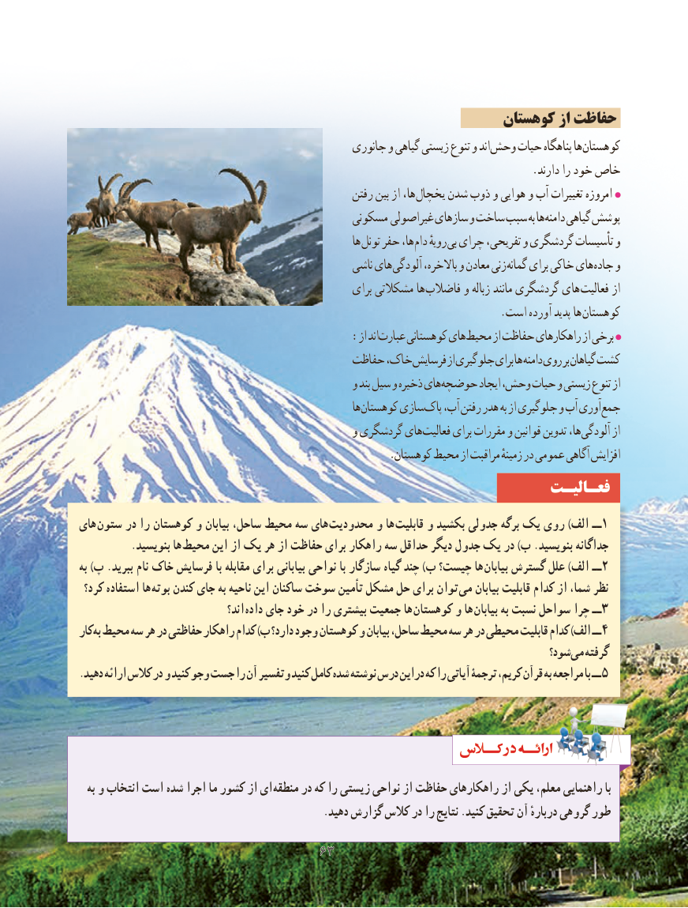

# PDF page 71

کوهستان از حفاظت
                                                جانوری و گیاهی زیستی تنوع و اند وحش حیات پناهگاه ها کوهستان
                                                                                  .دارند را خود خاص
                                                    رفتن بین از ها، یخچال شدن ذوب و هوایی و آب تغییرات امروزه
                                              مسکونی غیراصولی سازهای و ساخت سبب به ها دامنه گیاهی پوشش
                                                               ها تونل حفر ها، دام رویهٔ بی چرای تفریحی، و گردشگری تأسیسات و
                                                     ناشی های آلودگی باالخره، و معادن زنی گمانه برای خاکی های جاده و
                                                       برای مشکالتی ها فاضالب و زباله مانند گردشگری های فعالیت از
          . است آورده پدید ها کوهستان
                   : از اندعبارت کوهستانی های محیط از حفاظت راهکارهای از برخی
                                          حفاظت خاک، فرسایش از جلوگیری برای ها دامنه روی بر گیاهان کشت
                                                  و بند سیل و ذخیره های حوضچه ایجاد وحش، حیات و زیستی تنوع از
                                                               ها کوهستان سازی پاک آب، رفتن هدر به از جلوگیری و آب آوری جمع
                                                  و گردشگری های فعالیت برای مقررات و قوانین تدوین ها، آلودگی از
                                                        .کوهستان محیط از مراقبت زمینهٔ در عمومی آگاهی افزایش
                                                               فعـالیـت
های ستون در را کوهستان و بیابان ساحل، محیط سه های محدودیت و ها  قابلیت و بکشید جدولی برگه یک روی )الف ــ1
          .بنویسید ها محیط این از یک هر از حفاظت برای راهکار سه حداقل دیگر جدول یک در )ب .بنویسید جداگانه
به )پ .ببرید نام خاک فرسایش با مقابله برای بیابانی نواحی با سازگار گیاه چند )ب چیست؟ ها بیابان گسترش علل )الف ــ2
 کرد؟ استفاده ها بوته کندن جای به ناحیه این ساکنان سوخت تأمین مشکل حل برای توان  می بیابان قابلیت کدام از شما، نظر
                                   اند؟  داده جای خود در را بیشتری جمعیت ها کوهستان و ها بیابان به نسبت سواحل چرا ــ 3
کار به محیط سه هر در حفاظتی راهکار کدام )ب دارد؟ وجود کوهستان و بیابان ساحل، محیط سه هر در محیطی قابلیت کدام )الف ــ 4
                                                                                      شود؟ می گرفته
. دهید ارائه کالس در و کنید وجو جست را آن وتفسیر کنید کامل شده نوشته درس دراین که را آیاتی ترجمۀ کریم، قرآن به مراجعه با ــ 5

  به و انتخاب است شده اجرا ما کشور از ای منطقه در که را زیستی نواحی از حفاظت راهکارهای از یکی معلم، راهنمایی با
                                                .دهید گزارش کالس در را نتایج .کنید تحقیق آن دربارهٔ گروهی طور

                                6363

