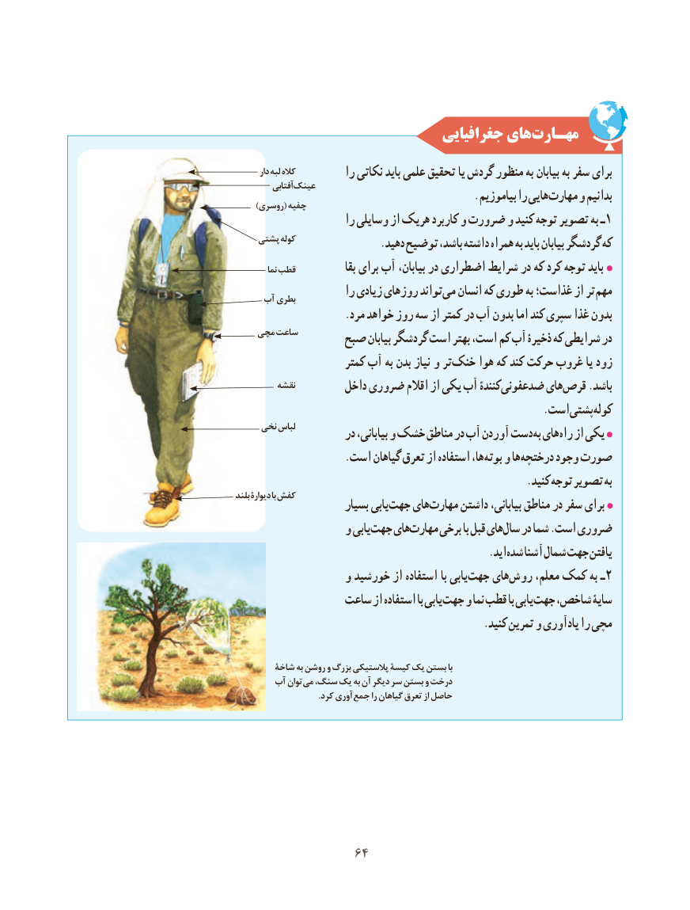

# PDF page 72

جغرافیایی هایمهـارت‌
       دار لبه کاله          را نکاتی باید علمی تحقیق یا گردش منظور به بیابان به سفر برای
          آفتابیعینک
                                               .بیاموزیم را هایی مهارت و بدانیم      )روسری( چفیه
                      را وسایلی از هریک کاربرد و ضرورت و کنید توجه تصویر به ١ـ
    پشتی کوله                .دهید توضیح باشد، داشته همراه به باید بیابان گردشگر که
          نما قطب             بقا برای آب بیابان، در اضطراری شرایط در که کرد توجه باید
                      را زیادی روزهای تواند می انسان که طوری به غذاست؛ از تر مهم     آب بطری
                     .مرد خواهد روز سه از کمتر در آب بدون اما کند سپری غذا بدون
    مچی ساعت       صبح بیابان گردشگر است بهتر است، کم آب ذخیرۀ که شرایطی در
                      کمتر آب به بدن نیاز و تر خنک هوا که کند حرکت غروب یا زود
         نقشه         داخل ضروری اقالم از یکی آب کنندۀ ضدعفونی های قرص .باشد
            . استپشتیکوله
     نخی لباس                     در بیابانی، و خشک مناطق در آب آوردن دست به های راه از یکی
                     .است گیاهان تعرق از استفاده ها، بوته و ها درختچه وجود صورت
                                                         .کنید توجه تصویر به
بلند دیوارۀ با کفش                       بسیار یابی جهت های مهارت داشتن بیابانی، مناطق در سفر برای
                 و یابی جهت های مهارت برخی با قبل های سال در شما .است ضروری
                         . ایدشده آشنا شمال جهت یافتن
                 و خورشید از استفاده با یابی جهت های روش٢معلم، کمک به ـ
                ساعت از استفاده با یابی جهت و نما قطب با یابی جهت شاخص، سایۀ
                                                .کنید تمرین و یادآوری را مچی

        شاخۀ به روشن و بزرگ پالستیکی کیسۀ یک بستن با
       آب توان می سنگ، یک به آن دیگر سر بستن و درخت
     . کرد آوریجمع را گیاهان تعرق از حاصل

                 6464

