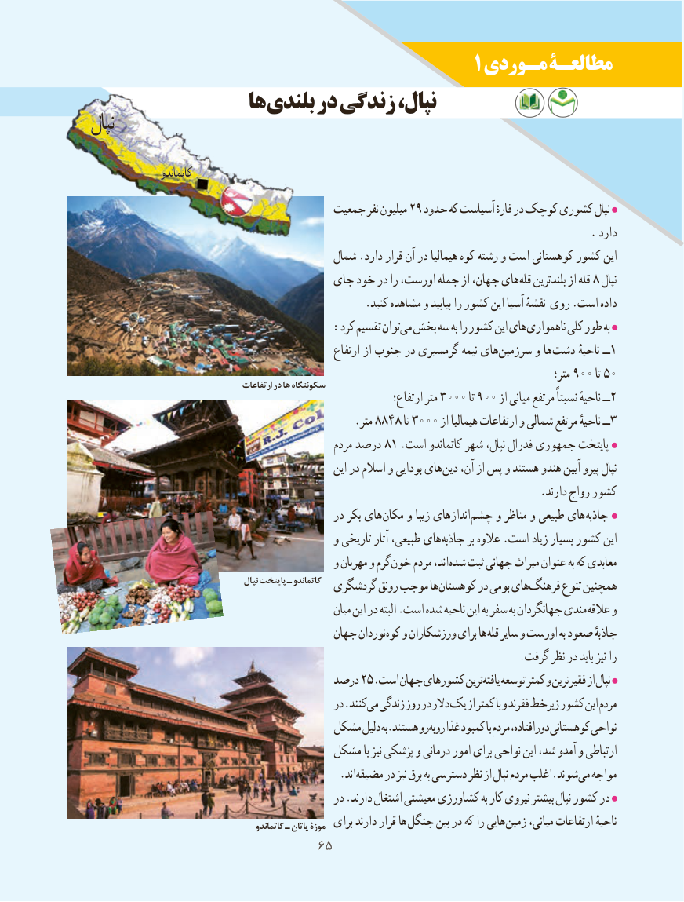

# PDF page 73

1 مـوردی مطالعـۀ
                 ها بلندی در زندگی نپال،
نپال

                 کاتماندو
                                      جمعیت نفر میلیون 29 حدود که آسیاست قارهٔ در کوچک کشوری نپال
                                                                                           . دارد
                                          شمال .دارد قرار آن در هیمالیا کوه رشته و است کوهستانی کشور این
                                   جای خود در را اورست، جمله از جهان، های قله بلندترین از قله 8 نپال
                                                  .کنید مشاهده و بیابید را کشور این آسیا نقشهٔ روی .است داده
                                   :کرد تقسیم توان می بخش سه به را کشور این های ناهمواری کلی طور به
                                                       ارتفاع از جنوب در گرمسیری نیمه های سرزمین و ها دشت ناحیهٔ ــ 1
                                                                                                              متر؛ 900 تا 50                                        ارتفاعات در ها سکونتگاه
                                                                     ارتفاع؛ متر 3000 تا 900 از میانی مرتفع نسبتاً ناحیهٔ ــ2
                                                .متر 8848 تا 3000 از هیمالیا ارتفاعات و شمالی مرتفع ناحیهٔ ــ3
                                                   مردم درصد 81 .است کاتماندو شهر نپال، فدرال جمهوری پایتخت
                                                      این در اسالم و بودایی های دین آن، از پس و هستند هندو آیین پیرو نپال
                                                                                  .دارند رواج کشور
                                              در بکر های مکان و زیبا اندازهای چشم و مناظر و طبیعی های جاذبه
                                            و تاریخی آثار طبیعی، های جاذبه بر عالوه .است زیاد بسیار کشور این
                                            و مهربان و گرم خون مردم اند، شده ثبت جهانی میراث عنوان به که معابدی
                                          نپال پایتخت ـ کاتماندو  گردشگری رونق موجب ها کوهستان در بومی های فرهنگ تنوع همچنین
                                                       میان این در البته .است شده ناحیه این به سفر به جهانگردان مندی عالقه و
                                         جهان نوردان کوه و ورزشکاران برای ها قله سایر و اورست به صعود جاذبهٔ
                                                                              .گرفت نظر در باید نیز را
                                      درصد 25.است جهان کشورهای ترین یافته توسعه کمتر و فقیرترین از نپال
                                                در .کنند می زندگی روز در دالر یک از کمتر با و فقرند زیرخط کشور این مردم
                                   مشکل دلیل به.هستند رو روبه غذا کمبود با مردم دورافتاده، کوهستانی نواحی
                                   مشکل با نیز پزشکی و درمانی امور برای نواحی این شد، آمدو و ارتباطی
                           . اندمضیقه در نیز برق به دسترسی نظر از نپال مردم اغلب.شوند می مواجه
                                              در .دارند اشتغال معیشتی کشاورزی به کار نیروی بیشتر نپال کشور در
                                              کاتماندو ـ پاتان موزۀ  برای دارند قرار ها جنگل بین در که را هایی زمین میانی، ارتفاعات ناحیهٔ
                               6565

