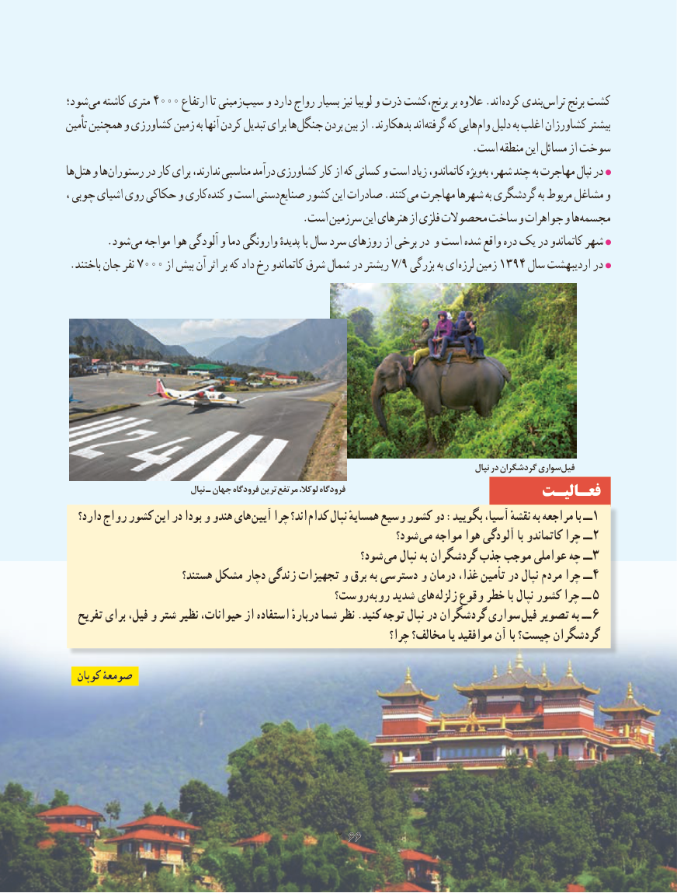

# PDF page 74

شود؛ می کاشته متری 4000 ارتفاع تا زمینی سیب و دارد رواج بسیار نیز لوبیا و ذرت برنج،کشت بر عالوه .اند کرده بندی تراس برنج کشت
تأمین همچنین و کشاورزی زمین به آنها کردن تبدیل برای ها جنگل بردن بین از .بدهکارند اند گرفته که هایی وام دلیل به اغلب کشاورزان بیشتر
                                                                           .است منطقه این مسائل از سوخت
ها هتل و ها رستوران در کار برای ندارند، مناسبی درآمد کشاورزی کار از که کسانی و است زیاد کاتماندو، ویژه به شهر، چند به مهاجرت نپال در
، چوبی اشیای روی حکاکی و کاری کنده و است دستی صنایع کشور این صادرات .کنند می مهاجرت شهرها به گردشگری به مربوط مشاغل و
                                            .است سرزمین این هنرهای از فلزی محصوالت ساخت و جواهرات و ها مجسمه
   . شود می مواجه هوا آلودگی و دما وارونگی پدیدهٔ با سال سرد روزهای از برخی در و است شده واقع دره یک در کاتماندو شهر
 .باختند جان نفر 7000 از بیش آن اثر بر که داد رخ کاتماندو شرق شمال در ریشتر 7/9 بزرگی به ای لرزه زمین 1394 سال اردیبهشت در

                                                                                                                 نپال در گردشگران سواری فیل
                                  نپال ـ جهان فرودگاه ترین مرتفع لوکال، فرودگاه                                                                 فعـالیـت
   دارد؟ رواج کشور این در بودا و هندو های آیین چرا اند؟ کدام نپال همسایهٔ وسیع کشور دو :بگویید آسیا، نقشهٔ به مراجعه با ــ1
                                                           شود؟ می مواجه هوا آلودگی با کاتماندو چرا ــ 2
                                                    شود؟ می نپال به گردشگران جذب موجب عواملی چه ــ 3
                       هستند؟ مشکل دچار زندگی تجهیزات و برق به دسترسی و درمان غذا، تأمین در نپال مردم چرا ــ 4
                                        روست؟ روبه شدید های زلزله وقوع خطر با نپال کشور چرا ــ 5
  تفریح برای فیل، و شتر نظیر حیوانات، از استفاده دربارهٔ شما نظر .کنید توجه نپال در گردشگران سواری فیل تصویر به ــ  6
                                                                  چرا؟ مخالف؟ یا موافقید آن با چیست؟ گردشگران

  کوپانکوپان صومعۀصومعۀ

                                  3 6666

