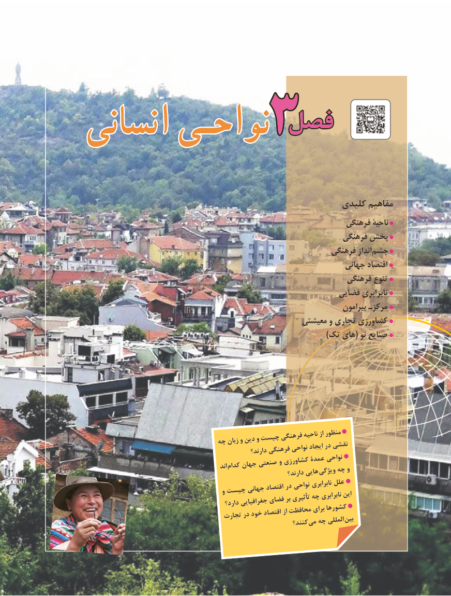

# PDF page 75

فصلفصلانسانیانسانی نواحـینواحـی

                                                    کلیدی مفاهیم
                                                               فرهنگی ناحیۀ
                                                               فرهنگی پخش
                                                            فرهنگی انداز‌چشم
                                                                جهانی اقتصاد
                                                                فرهنگی تنوع
                                                           فضایی نابرابری
                                                                          پیرامون مرکزـ
                                                    معیشتی و تجاری کشاورزی
                                                                                         )تک های( نو صنایع

                             چه زبان و دین و چیست فرهنگی ناحیه از منظور                                                        دارند؟ فرهنگی نواحی ایجاد در نقشی
                                                اند کدام جهان صنعتی و کشاورزی عمدۀ نواحی                                                                     دارند؟ هایی ویژگی چه و
                                 و چیست جهانی اقتصاد در نواحی نابرابری علل
                                             دارد؟ جغرافیایی فضای بر تأثیری چه نابرابری این
                                    تجارت در خود اقتصاد از محافظت برای کشورها                                                              کنند؟ می چه المللی بین

