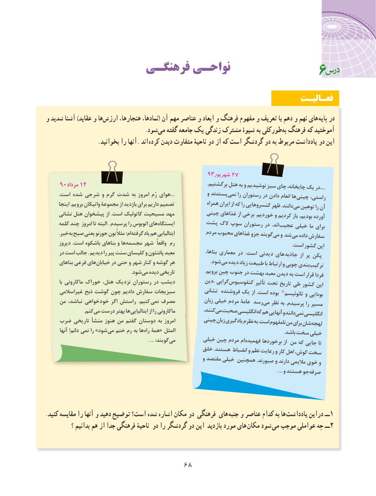

# PDF page 76

فرهنگـی نواحـی                                    6
                                                              فعـالیـت
و شدید آشنا )عقاید و هاارزش‌      هنجارها، نمادها،( آن مهم عناصر و ابعاد و فرهنگ مفهوم و تعریف با دهم و نهم های  پایه در
                                    .شود‌می گفته جامعه یک زندگی مشترک شیوۀ به طورکلیبه‌ فرهنگ که آموختید
  . بخوانید را آنها. اند کرده دیدن متفاوت ناحیۀ دو از که است گردشگر دو به مربوط یادداشت دو این

                                             93شهریور 27
    90مرداد 12                                                                           .برگشتیم هتل به و نوشیدیم سبز چای چایخانه، یک در....
....است شده شرجی و گرم شدت به امروز رُم هوای             و پسندند نمی را رستوران در دادن انعام ها چینی راستی،
      اینجا .برویم واتیکان مجموعۀ از بازدید برای داریم تصمیم             همراه ایران از که را کنسروهایی ظهر .دانند می توهین را آن
     نشانی هتل پیشخوان از .است کاتولیک مسیحیت مهد          چینی غذاهای از برخی .خوردیم و کردیم باز بودیم، آورده
     کلمه چند امروز تا البته . پرسیدم را اتوبوس های ایستگاه        پشت الک سوپ رستوران در .اند عجیب خیلی ما برای
          .خیر به صبح یعنی جورنو بون مثالً ام؛ گرفته یاد هم ایتالیایی           مردم محبوب غذاهای جزو گویند می و شد می داده سفارش
      دیروز .است باشکوه بناهای و ها مجسمه شهر  واقعاً رم                                                                         .است کشور این
     در است جالب . دیدیم را پیر سنت کلیسای و پانتئون معبد               بناها، معماری در .است دیدنی های جاذبه از پر پکن
      بناهای فرعی های خیابان در حتی و شهر کنار و گوشه هر                      .شود می دیده زیاد طبیعت با ارتباط و چوبی بندی ترکیب
                                                              .شود می دیده تاریخی                  .برویم چین جنوب در بهشت معبد دیدن به است قرار فردا
         با ماکارونی خوراک هتل، نزدیک رستوران در دیشب           ،دین گرایی کنفوسیوس تأثیر تحت تاریخ طی کشور این
     غیراسالمی ذبح گوشت چون دادیم سفارش سبزیجات           نشانی فروشنده یک از .است بوده تائوئیسم٭ و بودایی
    من نباشد، خودخواهی اگر راستش .کنیم نمی مصرف            زبان خیلی مردم عامۀ رسد می نظر به .پرسیدم را مسیر
                            .کنم می درست بهتر ها ایتالیایی از را ماکارونی            کنند،می  صحبتانگلیسیکههم آنهاییودانندنمی    انگلیسی
    ضرب تاریخی منشأ هنوز من گفتم دوستان به امروز         چینیزبانیادگیرینظرمبه.استنامفهوممنبرایشانلهجه
       آنها !دانم نمی را »شود می ختم رم به ها راه همۀ« المثل                                                                    .باشد سخت خیلی
                                                                          . ... :گویند می         خیلی چین مردم ام فهمیده برخوردها از من که جایی تا
                                             خلق .هستند انضباط و نظم رعایت و کار اهل کوش، سخت
                                                         و مقتصد خیلی همچنین .صبورند و دارند مالیمی خوی و
                                                                                                                                                . ... و هستند جو صرفه

.کنید مقایسه را آنها و دهید توضیح است؟ شده اشاره مکان دو فرهنگی های  جنبه و عناصر کدام به ها  یادداشت دراین ــ1
            ؟ بدانیم هم از جدا فرهنگی ناحیۀ دو را گردشگر دو این بازدید مورد های مکان شود می موجب عواملی چه ــ 2

                                  6868

