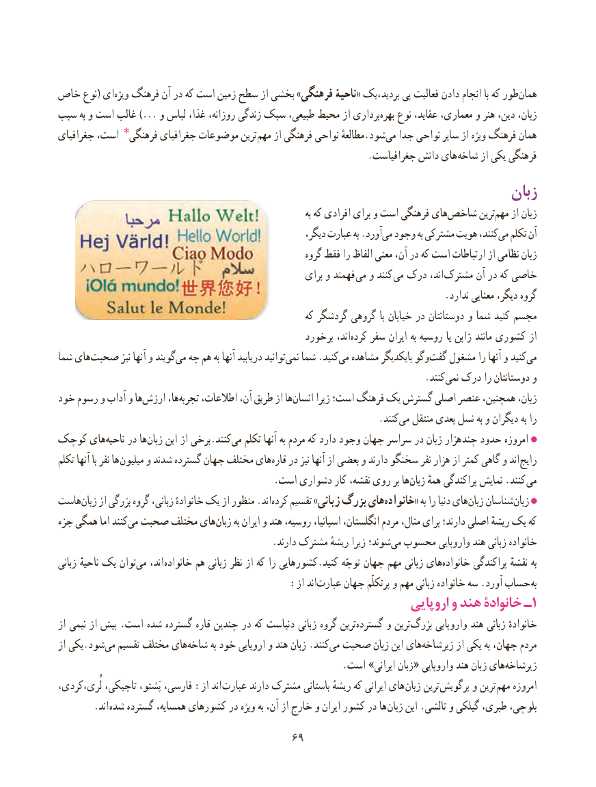

# PDF page 77

خاص نوع( ای‌ویژه فرهنگ آن در که است زمین سطح از بخشی »فرهنگی ناحیۀ« بردید،یک پی فعالیت دادن انجام با که طور‌همان
سبب به و است غالب ...) و لباس غذا، روزانه، زندگی سبک طبیعی، محیط از برداریبهره‌   نوع عقاید، معماری، و هنر دین، زبان،
جغرافیای است، فرهنگی٭ جغرافیای موضوعات ترین  مهم از فرهنگی نواحی مطالعهٔ.شودمی‌  جدا نواحی سایر از ویژه فرهنگ همان
       . جغرافیاست دانش های شاخه از یکی فرهنگی
                                                                    زبان
                                                                                   به که افرادی برای و است فرهنگی هایشاخص‌       ترینمهم‌    از زبان
                                                            دیگر، عبارت به .آوردمی‌  وجود به مشترکی هویت کنند،می‌  تکلم آن
                                                           گروه فقط را الفاظ معنی آن، در که است ارتباطات از نظامی زبان
                                                         برای و فهمند می و کنند می درک اند، مشترک آن در که خاصی
                                                                                 .ندارد معنایی دیگر، گروه
                                                          که گردشگر گروهی با خیابان در دوستانتان و شما کنید مجسم
                                                     برخورد اند،کرده‌    سفر ایران به روسیه یا ژاپن مانند کشوری از
شما های‌صحبت نیز آنها و گویندمی‌  چه هم به آنها دریابید توانیدنمی‌   شما .کنیدمی‌  مشاهده بایکدیگر وگوگفت‌   مشغول را آنها و کنیدمی‌
                                .‌کنند نمی درک را دوستانتان و
خود رسوم و آداب و هاارزش‌      ها،تجربه‌    اطالعات، آن، طریق از هاانسان‌      زیرا است؛ فرهنگ یک گسترش اصلی عنصر همچنین، زبان،
                            .‌کنندمی منتقل بعدی نسل به و دیگران به را
کوچک هایناحیه‌    در هازبان‌    این از برخی.کنندمی‌   تکلم آنها به مردم که دارد وجود جهان سراسر در زبان هزار چند حدود امروزه
تکلم آنها با نفر ها  میلیون و شدند گسترده جهان مختلف هایقاره‌   در نیز آنها از بعضی و دارند سخنگو نفر هزار از کمتر گاهی و اند رایج
                                             .است دشواری کار نقشه، روی بر ها‌زبان همهٔ پراکندگی نمایش .کنند می
هاست ‌زبان از بزرگی گروه زبانی، خانوادهٔ یک از منظور .اند ‌کرده تقسیم »زبانی بزرگ هایخانواده‌       « به را دنیا های‌زبان شناسانزبان‌
جزء همگی اما کنندمی‌ صحبت مختلف های‌زبان به ایران و هند روسیه، اسپانیا، انگلستان، مردم مثال، برای دارند؛ اصلی ریشهٔ یک که
    .‌دارند مشترک ریشهٔ زیرا شوند؛می محسوب واروپایی هند زبانی خانواده
زبانی ناحیهٔ یک توان ‌می اند، خانواده هم زبانی نظر از که را کشورهایی.کنید توجّه جهان مهم زبانی هایخانواده‌       پراکندگی نقشهٔ به
                                       :از اند‌عبارت جهان پرتکلّم و مهم زبانی خانواده سه .آورد حساب به
                                                                اروپایی و هند خانوادۀ ـ1
از نیمی از بیش .است شده گسترده قاره چندین در که دنیاست زبانی گروه ترینگسترده‌      و ترینبزرگ‌      واروپایی هند زبانی خانوادهٔ
از یکی.شودمی‌  تقسیم مختلف های‌شاخه به خود اروپایی و هند زبان .کنندمی‌  صحبت زبان این هایزیرشاخه‌        از یکی به جهان، مردم
                                                           .است »ایرانی زبان« واروپایی هند زبان هایزیرشاخه‌
لُری،کردی، تاجیکی، پَشتو، فارسی، :از اند  عبارت دارند مشترک باستانی ریشهٔ که ایرانی های زبان ترین پرگویش و ترین مهم امروزه
    . اند شده گسترده همسایه، کشورهای در ویژه به آن، از خارج و ایران کشور در ها زبان این .تالشی و گیلکی طبری، بلوچی،
                                       6969

