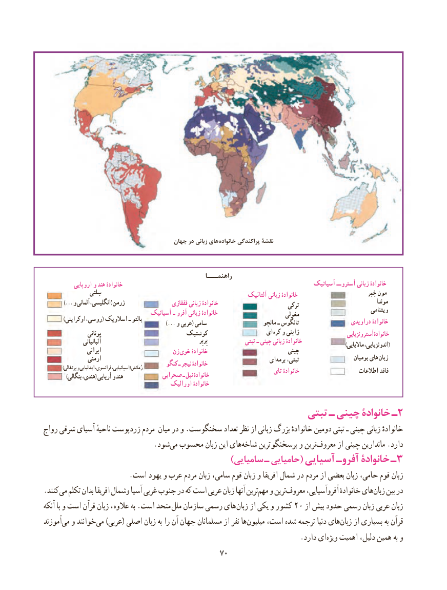

# PDF page 78

جهان در زبانی های خانواده پراکندگی نقشۀ

                                                       راهنمـــا
            اروپایی و هند خانوادۀ                                                              آسیاتیک آستروــ زبانی خانوادۀ
                    سِلتی                                                                           آلتائیک زبانی خانوادۀ                                          خِمِر مون
         ...) و آلمانی ،ژرمنانگلیسی(                       قفقازی زبانی خانوادۀ                         ترکی                               موندا                                                                                                                                   ویتنامی                                    آسیانیک ـ آفرو زبانی خانوادۀ                        مغولی  ) اوکراینی ،بالتوروسی( اسالویک ـ                                                    ...) و عربی( سامی                      مانچو ـ تانگوس                  دراویدی خانوادۀ
                   یونانی                        کوشتیک                   ای کره و ژاپنی                   آسترونزیاییخانوادۀ
                   آلبانیانی                                                                       بِربِر               تبتی ـ چینی زبانی خانوادۀ                                                                                                                                                                            )ماالیایی اندونزیایی،(
                  ایرانی                      زن  خوی خانوادۀ                             چینی
                ارمنی                                                     ای برمه تبتی،                      بومیان های  زبان                                            کنگو ـ نیجر خانوادۀ              )پرتغالی و ایتالیایی فرانسوی، اسپانیایی،( رُمانش                                                 تای خانوادۀ                     اطالعات فاقد             )بنگالی هندی،( آریایی و هند            صحرایی ـ نیل خانوادۀ
                                          اورالیک خانوادۀ

                                                    تبتی ـ چینی خانوادۀ ـ2
رواج شرقی آسیای ناحیهٔ زردپوست مردم میان در و .سخنگوست تعداد نظر از زبانی بزرگ خانوادهٔ دومین تبتی ـ چینی زبانی خانوادهٔ
            .‌شودمی محسوب زبان این هایشاخه‌     ترین پرسخنگو و ترینمعروف‌       از چینی ماندارین .دارد
                                              )سامیایی ـ حامیایی( آسیایی آفروـ خانوادۀ ـ ۳
                        .است یهود و عرب مردم زبان سامی، قوم زبان و افریقا شمال در مردم از بعضی زبان حامی، قوم زبان
. کنند می تکلم بدان افریقا وشمال آسیا غربی جنوب در که است عربی زبان آنها ترینمهم‌   و ترینمعروف‌      آفروآسیایی، خانوادهٔ هایزبان‌    بین در
آنکه با و است قرآن زبان ،  عالوه به .است متحد ملل سازمان رسمی های زبان۲۰از یکی و کشور    از بیش حدود رسمی زبان عربی زبان
آموزند ‌می و خوانند‌می )عربی( اصلی زبان به را آن جهان مسلمانان از نفر ها‌میلیون است، شده ترجمه دنیا هایزبان‌    از بسیاری به قرآن
                  .‌دارد ایویژه اهمیت دلیل، همین به و
                                          7070

