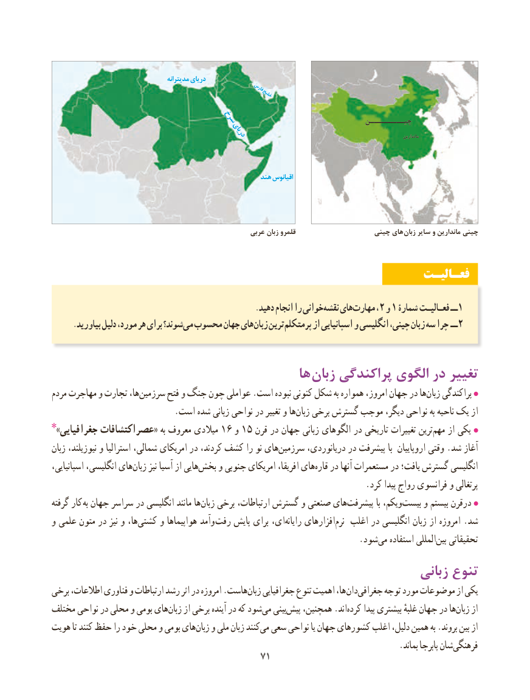

# PDF page 79

مدیترانه دریای
                                                           فارس                                                            خلیج
                          سرخ                                چیـــــــــن
                                           دریای                                                                              ماندارین

                                                         هند اقیانوس

                                                      عربی زبان قلمرو                    چینی های زبان سایر و ماندارین چینی

                                                                 فعـالیـت

      .‌دهید انجام را خوانینقشه هایمهارت۲‌       ، و۱ شمارۀ فعـالیـت ــ1
     .بیاورید دلیل مورد، هر برای شوند؟می‌  محسوب جهان هایزبان‌   ترینپرمتکلم‌       از اسپانیایی و انگلیسی چینی، زبان‌   سه چرا ــ2

                                          ها  زبان پراکندگی الگوی در تغییر
مردم مهاجرت و تجارت ها،سرزمین‌      فتح و جنگ چون عواملی .است نبوده کنونی شکل به همواره امروز، جهان در هازبان‌    پراکندگی
                             .است شده زبانی نواحی در تغییر و هازبان‌   برخی گسترش موجب دیگر، نواحی به ناحیه یک از
٭ »جغرافیایی عصراکتشافات« به معروف میالدی 16 و 15 قرن در جهان زبانی الگوهای در تاریخی تغییرات ترینمهم‌    از یکی
زبان نیوزیلند، و استرالیا شمالی، امریکای در کردند، کشف را نو هایسرزمین‌       دریانوردی، در پیشرفت با  اروپاییان وقتی .شد آغاز
اسپانیایی، انگلیسی، های‌زبان نیز آسیا از هاییبخش‌    و جنوبی امریکای افریقا، هایقاره‌   در آنها مستعمرات در یافت؛ گسترش انگلیسی
                                                                          .کرد پیدا رواج فرانسوی و پرتغالی
گرفته کار به جهان سراسر در انگلیسی مانند هازبان‌   برخی ارتباطات، گسترش و صنعتی هایپیشرفت‌            با ویکم،بیست‌     و بیستم درقرن
و علمی متون در نیز و ها،کشتی‌     و هواپیماها وآمد رفت پایش برای ای،‌رایانه افزارهای‌نرم اغلب در انگلیسی زبان از امروزه .شد
                                                                        .شود‌می استفاده المللی‌بین تحقیقاتی
                                                                 زبانی تنوع
برخی اطالعات، فناوری و ارتباطات رشد اثر در امروزه .هاستزبان‌    جغرافیایی تنوع اهمیت ها، دانجغرافی‌      توجه مورد موضوعات از یکی
مختلف نواحی در محلی و بومی هایزبان‌    از برخی آینده در که شودمی‌   بینیپیش‌   همچنین، .اندکرده‌     پیدا بیشتری غلبهٔ جهان در هازبان‌    از
هویت تا کنند حفظ را خود محلی و بومی هایزبان‌   و ملی زبان کنندمی‌  سعی نواحی یا جهان کشورهای اغلب دلیل، همین به .بروند بین از
            .‌بماند پابرجا شانفرهنگی
                                           7171

