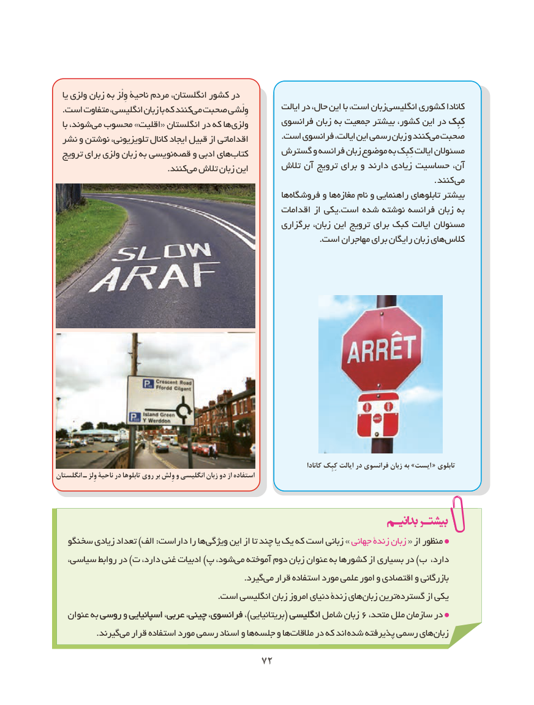

# PDF page 80

یا ولزی زبان به وِلْز ناحیۀ مردم انگلستان، کشور در
                                                           ایالت در حال، این با است، زبانانگلیسی‌      کشوری کانادا. است متفاوت انگلیسی، زبان با که کنندمی صحبت وِلْشی
                                                 فرانسوی زبان به جمعیت بیشتر کشور، این در کِبِککِبِک   با شوند، می محسوب »اقلیت« انگلستان در که ها ولزی
   .‌است فرانسوی ایالت، این رسمی زبان و کنندمی صحبت نشر و نوشتن تلویزیونی، کانال ایجاد قبیل از اقداماتی
                                     گسترش و فرانسه زبان موضوع به کِبِک ایالت مسئوالن  ترویج برای ولزی زبان به نویسی ‌قصه و ادبی هایکتاب‌
                                              تالش آن ترویج برای و دارند زیادی حساسیت آن،          . کنندمی تالش زبان این
                                  .‌کنند می
                                                        هافروشگاه‌       و هامغازه‌     نام و راهنمایی تابلوهای بیشتر
                                                     اقدامات از یکی.است شده نوشته فرانسه زبان به
                                                       برگزاری زبان، این ترویج برای کبک ایالت مسئوالن
    .‌است مهاجران برای رایگان زبان هایکالس

                                                                                                        کانادا کِبِک ایالت در فرانسوی زبان به »ایست « تابلوی
انگلستان ـ وِلز ناحیۀ در تابلوها روی بر وِلش و انگلیسی زبان دو از استفاده

  سخنگو زیادی تعداد )الف :داراست را ها ویژگی این از تا چند یا یک که است زبانی » جهانی زندۀ زبان « از منظور
،شود،سیاسی روابط در )ت دارد، غنی ادبیات )پ    می‌  آموخته دوم زبان عنوان به کشورها از بسیاری در )ب دارد،
                 .‌گیردمی قرار استفاده مورد علمی امور و اقتصادی و بازرگانی
  .‌است انگلیسی زبان امروز دنیای زندۀ هایزبان ترینگسترده‌        از یکی
   عنوان به روسیروسی و اسپانیاییاسپانیایی عربی،عربی چینی،چینی فرانسوی،فرانسوی ،)بریتانیایی( انگلیسیانگلیسی شامل زبان 6 ،متحد ملل سازمان در
               .گیرندمی‌  قرار استفاده مورد رسمی اسناد و هاجلسه‌    و هامالقات‌     در که اند شده پذیرفته رسمی هایزبان‌

                                    7272

