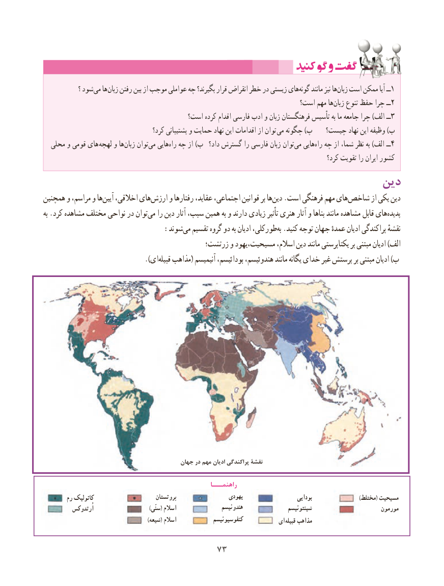

# PDF page 81

؟ شود می ها زبان رفتن بین از موجب عواملی چه بگیرند؟ قرار انقراض خطر در زیستی هایگونه‌    مانند نیز هازبان‌  است ممکن آیا ــ1
                                                                   است؟ مهم هازبان‌    تنوع حفظ چرا ــ2
                                      است؟ کرده اقدام فارسی ادب و زبان فرهنگستان تأسیس به ما جامعه چرا )الف ــ3
                                     کرد؟ پشتیبانی و حمایت نهاد این اقدامات از توان می چگونه )پ   چیست؟ نهاد این وظیفه )ب
  محلی و قومی های لهجه و ها ‌زبان توانمی‌   هایی ‌راه چه از )ب  داد؟ گسترش را فارسی زبان توان‌می هایی‌راه چه از شما، نظر به )الف ــ4
                                                                                                 کرد؟ تقویت را ایران کشور
                                                      دین
همچنین و مراسم، و هاآیین‌   اخالقی، هایارزش‌     و رفتارها عقاید، اجتماعی، قوانین بر هادین‌   .است فرهنگی مهم هایشاخص‌       از یکی دین
به .کرد مشاهده مختلف نواحی در توانمی‌   را دین آثار سبب، همین به و دارند زیادی تأثیر هنری آثار و بناها مانند مشاهده قابل هایپدیده‌
            :‌شوندمی تقسیم گروه دو به ادیان طورکلی،به‌ .کنید توجه جهان عمدهٔ ادیان پراکندگی نقشهٔ
                                         زرتشت؛ و مسیحیت،یهود اسالم، دین مانند یکتاپرستی بر مبتنی ادیان )الف
                   ).‌ایقبیله مذاهب( آنیمیسم بودائیسم، هندوئیسم، مانند یگانه خدای غیر پرستش بر مبتنی ادیان )ب

                                          جهان در مهم ادیان پراکندگی نقشۀ

                                                         راهنمـــا
        رم کاتولیک                        پروتستان                  یهودی                      بودایی                           )مختلط( مسیحیت
           اُرتدوکس                                )سنّی( اسالم                هندوئیسم                 شینتوئیسم                       مورمون
                                                            )شیعه( اسالم             کنفوسیوئیسم           ای  قبیله مذاهب

                                  7373

