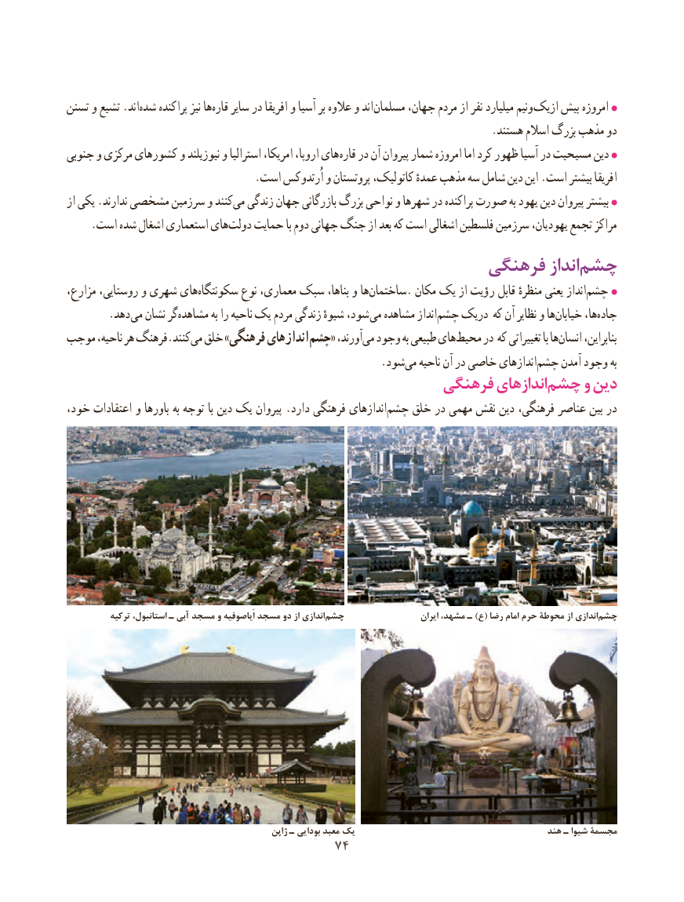

# PDF page 82

تسنن و تشیع .اندشده‌    پراکنده نیز هاقاره‌   سایر در افریقا و آسیا بر عالوه و اند مسلمان جهان، مردم از نفر میلیارد ونیم‌ ازیک بیش امروزه
                                                                             .هستند اسالم بزرگ مذهب دو
جنوبی و مرکزی کشورهای و نیوزیلند و استرالیا امریکا، اروپا، های قاره در آن پیروان شمار امروزه اما کرد ظهور آسیا در مسیحیت دین
                                  .است اُرتدوکس و پروتستان کاتولیک، عمدهٔ مذهب سه شامل دین این .است بیشتر افریقا
از یکی .ندارند مشخصی سرزمین و کنندمی‌  زندگی جهان بازرگانی بزرگ نواحی و شهرها در پراکنده صورت به یهود دین پیروان بیشتر
    .است شده اشغال استعماری هایدولت‌    حمایت با دوم جهانی جنگ از بعد که است اشغالی فلسطین سرزمین یهودیان، تجمع مراکز
                                           فرهنگی اندازچشم‌
مزارع، روستایی، و شهری هایسکونتگاه‌        نوع معماری، سبک بناها، و هاساختمان‌      . مکان یک از رؤیت قابل منظرهٔ یعنی اندازچشم‌
        .دهد می نشان گرمشاهده‌         به را ناحیه یک مردم زندگی شیوهٔ شود، می مشاهده اندازچشم‌   دریک که آن نظایر و هاخیابان‌      ها،جاده‌
موجب ناحیه، هر فرهنگ.کنندمی‌  خلق »فرهنگی اندازهایچشم‌    « آورند،می‌  وجود به طبیعی هایمحیط‌     در که تغییراتی با هاانسان‌      بنابراین،
                       .‌شودمی ناحیه آن در خاصی اندازهایچشم‌    آمدن وجود به
                                            فرهنگی اندازهایچشم‌    و دین
خود، اعتقادات و باورها به توجه با دین یک پیروان .دارد فرهنگی اندازهایچشم‌    خلق در مهمی نقش دین فرهنگی، عناصر بین در

           ترکیه استانبول، ـ آبی مسجد و اَیاصوفیه مسجد دو از اندازی‌چشم                     ایران مشهد، ـ )ع( رضا امام حرم محوطۀ از اندازی‌چشم

                                                   ژاپن ـ بودایی معبد یک                                         هند ـ شیوا مجسمۀ
                                    7474

