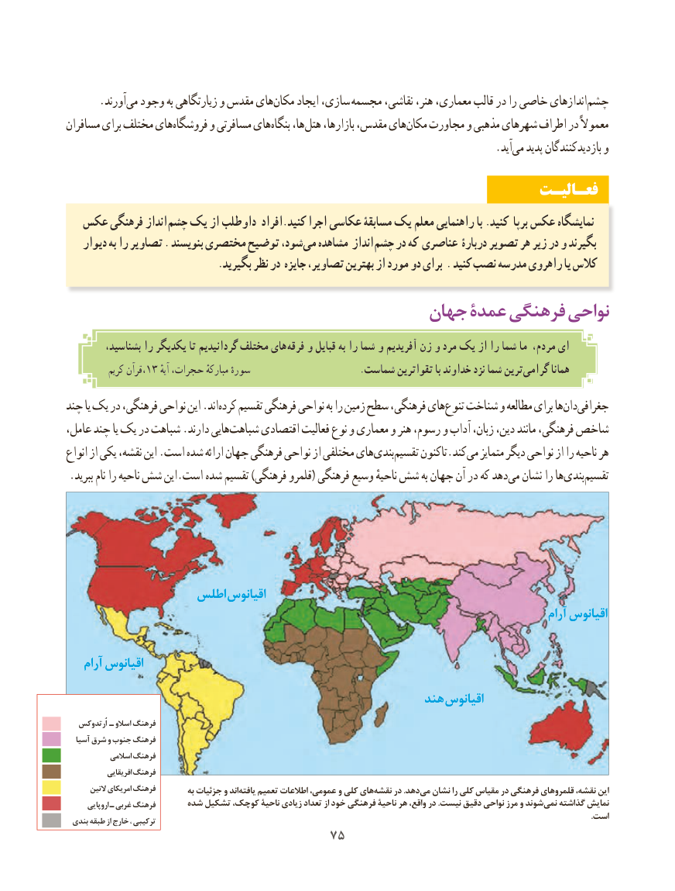

# PDF page 83

.‌آورندمی وجود به زیارتگاهی و مقدس هایمکان‌     ایجاد سازی،‌ مجسمه نقاشی، هنر، معماری، قالب در را خاصی اندازهایچشم‌
مسافران برای مختلف هایفروشگاه‌      و مسافرتی هایبنگاه‌    ها،هتل‌    بازارها، مقدس، هایمکان‌   مجاورت و مذهبی شهرهای اطراف در معموالً
                                            .‌آیدمی پدید بازدیدکنندگان و
                                                                 فعـالیـت
  عکس فرهنگی انداز چشم یک از داوطلب افراد.کنید اجرا عکاسی مسابقۀ یک معلم راهنمایی با .کنید برپا عکس نمایشگاه
    دیوار به را تصاویر . بنویسند مختصری توضیح شود، می مشاهده انداز چشم در که عناصری دربارۀ تصویر هر زیر در و بگیرند
                              .بگیرید نظر در جایزه تصاویر، بهترین از مورد دو برای . کنید نصب مدرسه راهروی یا کالس
                                     جهان عمدۀ فرهنگی نواحی
         بشناسید، را یکدیگر تا گردانیدیم مختلف های فرقه و قبایل به را شما و آفریدیم زن و مرد یک از را شما ما مردم، ای
           کریم ،قرآن13 ٔترینآیه حجرات، مبارکهٔ سورهٔ                        .شماست تقواترین با خداوند نزد شما         گرامی همانا
چند یا یک در فرهنگی، نواحی این .اندکرده‌   تقسیم فرهنگی نواحی به را زمین سطح فرهنگی، هایتنوع‌   شناخت و مطالعه برای هادان‌  جغرافی‌
عامل، چند یا یک در شباهت .دارند هاییشباهت‌     اقتصادی فعالیت نوع و معماری و هنر رسوم، و آداب زبان، دین، مانند فرهنگی، شاخص
انواع از یکی نقشه، این .است شده ارائه جهان فرهنگی نواحی از مختلفی هایبندی‌    تقسیم‌     تاکنون.کندمی‌   متمایز دیگر نواحی از را ناحیه هر
.‌ببرید نام را ناحیه شش این.است شده تقسیم )فرهنگی قلمرو( فرهنگی وسیع ناحیهٔ شش به جهان آن در که دهدمی نشان را هابندی‌    تقسیم‌

                  اطلس اقیانوس
                                                                                                   آرام اقیانوس

    آرام اقیانوس
                                                      هند اقیانوس  راهنمــا
   اُرتدوکس ـ اسالو فرهنگ
   آسیا شرق و جنوب فرهنگ
            اسالمی فرهنگ
             افریقایی فرهنگ
       التین امریکای فرهنگ         به جزئیات و اندیافته‌    تعمیم اطالعات عمومی، و کلی هاینقشه‌    در .دهدمی‌  نشان را کلی مقیاس در فرهنگی قلمروهای نقشه، این
       اروپایی ـ غربی فرهنگ      شده تشکیل کوچک، ناحیۀ زیادی تعداد از خود فرهنگی ناحیۀ هر واقع، در .نیست دقیق نواحی مرز و شوندنمی‌   گذاشته نمایش
                                                                                                                                                                                                                                                          .است بندی طبقه از خارج ، ترکیبی
                                   7575

