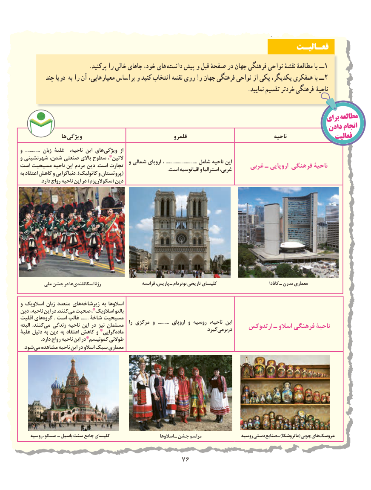

# PDF page 84

فعـالیـت
                         .پرکنید را خالی جاهای خود، های  دانسته پیش و قبل صفحۀ در جهان فرهنگی نواحی نقشۀ مطالعۀ با ــ1
         چند دویا به را آن معیارهایی، براساس و کنید انتخاب نقشه روی را جهان فرهنگی نواحی از یکی یکدیگر، همفکری با ــ 2
                                                                                  .نمایید تقسیم خردتر فرهنگی ناحیۀ

                                                                                           برایمطالعه
                                                                                     دادن انجام
                ها ویژگی                                   قلمرو                                  ناحیه                فعالیت
و  ............. زبان غلبۀ   ناحیه، این های ویژگی  از
و شهرنشینی شدن، صنعتی باالی سطوح التین٭،                                             و شمالی اروپای ، ............................ شامل ناحیه ایناست مسیحیت ناحیه این مردم دین .است تجارت                                     غربی ـ اروپایی فرهنگی ناحیۀ                                                                                                                   .است اقیانوسیه و استرالیا غربی،به اعتقاد کاهش و گرایی (دنیا ).کاتولیک و پروتستان
                .دارد رواج ناحیه این در )سکوالریزم( دین

         ملی جشن در ها اسکاتلندی رژۀ                   فرانسه پاریس، ـ نوتردام تاریخی کلیسای                                کانادا ـ مدرن معماری

و اسالویک زبان متعدد هایزیرشاخه‌         به اسالوها
دین ناحیه، این در .کنندمی‌ صحبت اسالویک٭، بالتو
اقلیت هایگروه‌        . است غالب ....... شاخۀ مسیحیت                                                               را مرکزی و  .......... اروپای و روسیه ناحیه، اینالبته  .کنندمی‌   زندگی ناحیه این در نیز مسلمان                                    ارتدوکس ـ اسالو فرهنگی ناحیۀ                              .‌گیرددربرمیغلبۀ دلیل به دین به اعتقاد کاهش و گرایی٭ ماده
                .دارد رواج ناحیه این در کمونیسم٭ طوالنی
 . شودمی مشاهده ناحیه این در اسالو سبک معماری

    روسیه مسکو، ـ باسیل سنت جامع کلیسای                         اسالوها ـ جشن مراسم                روسیه دستی صنایع ـ )ماتروشکا( چوبی های عروسک

                                        7676

