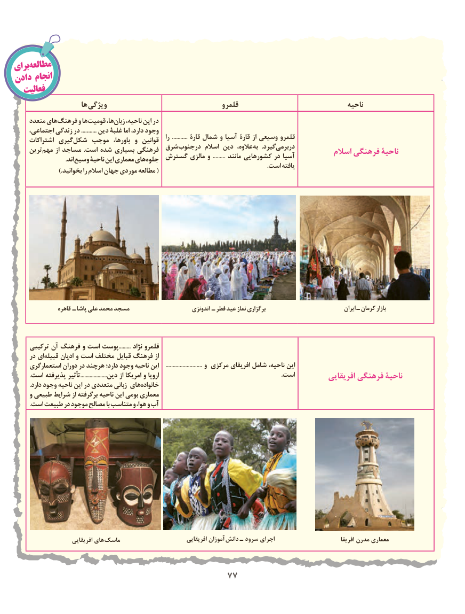

# PDF page 85

برایمطالعه
دادن انجام
   فعالیت
                     ها ویژگی                                   قلمرو                                  ناحیه
     متعدد هایفرهنگ‌      و هاقومیت‌       ها،زبان‌    ناحیه، این در
     اجتماعی، زندگی در ........... دین غلبۀ اما دارد، وجود                                                                      را  ........... قارۀ شمال و آسیا قارۀ از وسیعی قلمرو     اشتراکات گیری شکل موجب  باورها، و  قوانین                                   شرقدرجنوب‌        اسالم دین عالوه، به  .گیرددربرمی‌     ترین مهم از مساجد .است شده بسیاری فرهنگی                                                 اسالم فرهنگی ناحیۀ                                  گسترش مالزی و  ......... مانند کشورهایی در آسیا                                .اند وسیع ناحیۀ این معماری های جلوه                                                                                                                                                              .است یافته                      .)بخوانید را اسالم جهان موردی مطالعه (

                 قاهره ـ پاشا علی محمد مسجد                        اندونزی ـ فطر عید نماز برگزاری                                 ایران ـ کرمان بازار

     ترکیبی آن فرهنگ و است پوست......... نژاد قلمرو
     در ایقبیله‌     ادیان و است مختلف قبایل فرهنگ از
     استعمارگری دوران در هرچند دارد؛ وجود ناحیه این     .......................... و مرکزی افریقای شامل ناحیه، این
          .است پذیرفته تأثیر....................دین از امریکا و اروپا                                                                            .است          افریقایی فرهنگی ناحیۀ
          .دارد وجود ناحیه این در متعددی زبانی های خانواده
     و طبیعی شرایط از برگرفته ناحیه این بومی معماری
          .است طبیعت در موجود مصالح با متناسب و هوا، و آب

                       افریقایی های ماسک                          افریقایی آموزان دانش ـ سرود اجرای                             افریقا مدرن معماری

                                        7777

