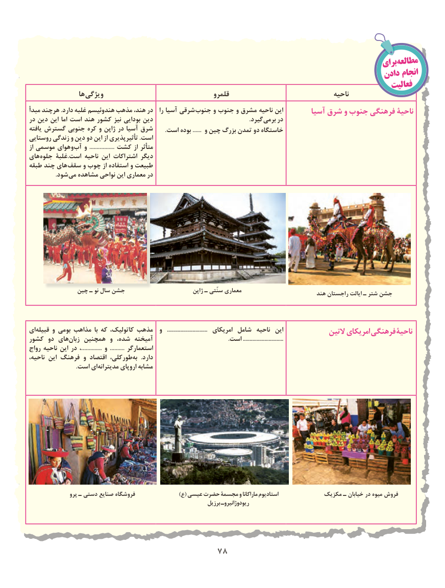

# PDF page 86

برایمطالعه
                                                                                    دادن انجام
                                                                                                فعالیت
                ها ویژگی                                   قلمرو                                  ناحیه
مبدأ هرچند .دارد غلبه هندوئیسم مذهب هند، در   را آسیا شرقی جنوب و جنوب و مشرق ناحیه این        آسیا شرق و جنوب فرهنگی ناحیۀ
در دین این اما است هند کشور نیز بودایی دین             . گیرد برمی در
یافته گسترش جنوبی کره و ژاپن در آسیا شرق        .است بوده ...... و چین بزرگ تمدن دو خاستگاه
روستایی زندگی و دین دو این از تأثیرپذیری .است
از موسمی هوای وآب‌   و  ................. کشت از متأثر
های جلوه غلبۀ.است ناحیه این اشتراکات دیگر
طبقه چند های سقف و چوب از استفاده و طبیعت
                 .شود می مشاهده نواحی این معماری در

             چین ـ نو سال جشن                          ژاپن ـ سنّتی معماری                                                                                             هند راجستان ایالت ـ شتر جشن

ایقبیله‌     و بومی مذاهب  با که کاتولیک، مذهب  و   ..............................  امریکای شامل  ناحیه  این              التین امریکای فرهنگی ناحیۀ
کشور دو هایزبان‌    همچنین و شده، آمیخته                                                 .است ..............................
رواج ناحیه این در ،.............. و  .......... استعمارگر
ناحیه، این فرهنگ و اقتصاد طورکلی،به‌    .دارد
    .‌است ایمدیترانه اروپای مشابه

                پرو ـ دستی صنایع فروشگاه                   )ع( عیسی حضرت مجسمۀ و ماراکانا استادیوم             مکزیک ـ خیابان در میوه فروش
                                                                     برزیل ریودوژانیروـ

                                     7878

