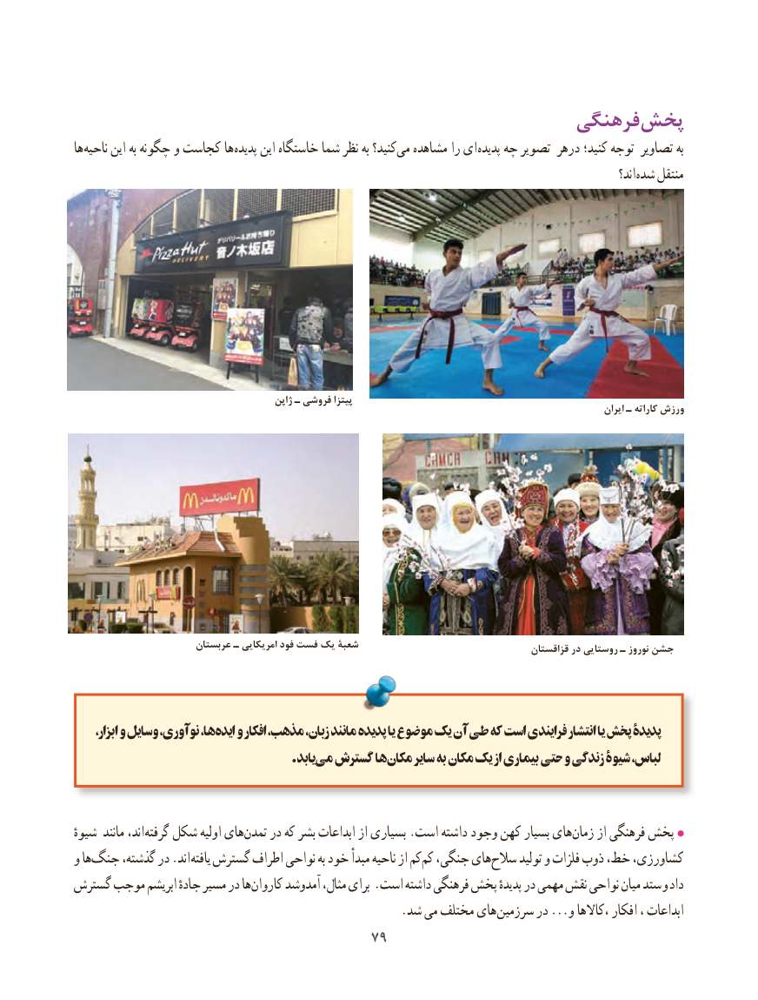

# PDF page 87

فرهنگی پخش
ها ناحیه این به چگونه و کجاست ها پدیده این خاستگاه شما نظر به کنید؟می‌  مشاهده را ای پدیده چه تصویر درهر کنید؛ توجه تصاویر به
                                                                                                                                اند؟ شده منتقل

                                             ژاپن ـ فروشی پیتزا                                                                                                                                    ایران ـ کاراته ورزش

                        عربستان ـ امریکایی فود فست یک شعبۀ                                                                                                 قزاقستان در روستایی ـ نوروز جشن

 ،ها،ابزار و وسایل نوآوری،   ایده‌   و افکار مذهب، زبان، مانند پدیده یا موضوع یک آن طی که است فرایندی انتشار یا پخش پدیدۀ
                                          .یابدمی‌  گسترش هامکان‌     سایر به مکان یک از بیماری‌     حتی و زندگی شیوۀ لباس،

ٔاند،شیوه مانند       گرفته شکل اولیه هایتمدن‌    در که بشر ابداعات از بسیاری .است داشته وجود کهن بسیار هایزمان‌    از فرهنگی پخش
و هاجنگ‌     گذشته، در .اند یافته گسترش اطراف نواحی به خود مبدأ ناحیه از کمکم‌  جنگی، هایسالح‌     تولید و فلزات ذوب خط، کشاورزی،
گسترش موجب ابریشم جادهٔ مسیر در هاکاروان‌     آمدوشد مثال، برای .است داشته فرهنگی پخش پدیدهٔ در مهمی نقش نواحی میان ستد و داد
       . شد می مختلف های سرزمین در ...و ،کاالها افکار ، ابداعات
                                     7979

