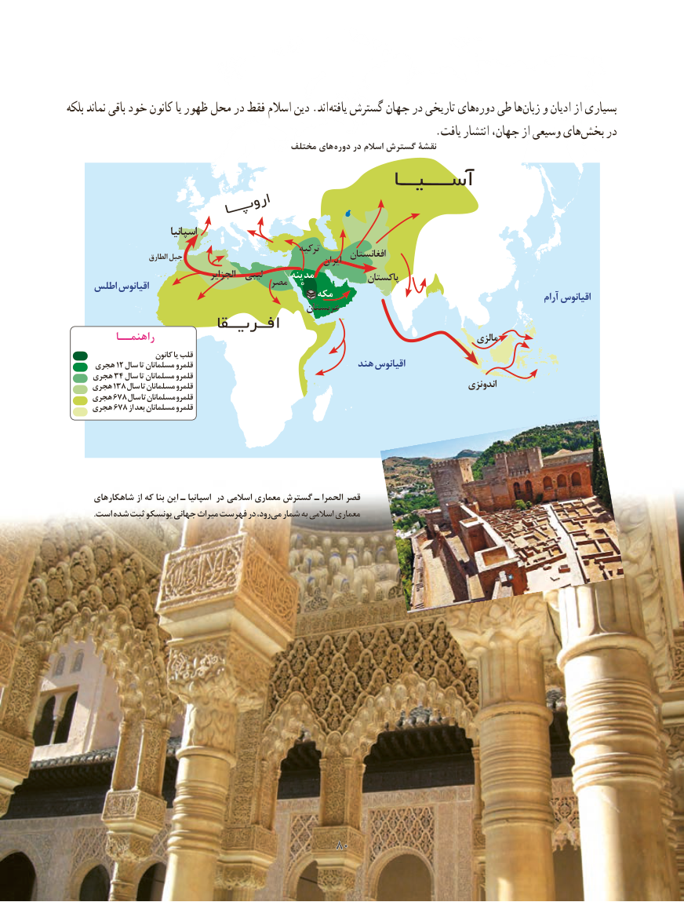

# PDF page 88

بلکه نماند باقی خود کانون یا ظهور محل در فقط اسالم دین .اند یافته گسترش جهان در تاریخی هایدوره‌   طی هازبان‌   و ادیان از بسیاری
     .‌یافت انتشار جهان، از وسیعی هایبخش در
                                            مختلف های دوره در اسالم گسترش نقشۀ

                           اسپانیا
                                                      ترکیه                          الطارق جبل                                         افغانستان                                                                    ایران
                                       الجزایر  لیبی      مدینه            پاکستان                                   مصر     اطلس اقیانوس                                               مکه                                                       آرام اقیانوس                                                 عربستان
          راهنمــا                                                                           مالزی
                         کانون یا قلب
      هجری١٢ سال تا مسلمانان قلمرو                               هند اقیانوس
     هجری٣٤ سال تا مسلمانان قلمرو
     هجری١٣٨ سال تا مسلمانان قلمرو                                                                  اندونزی
     هجری٦٧٨سال تا مسلمانان قلمرو
     هجری٦٧٨ از بعد مسلمانان قلمرو

                                                                           مختلف هایدوره‌    در اسالم گسترش نقشۀ      شاهکارهای از که بنا این ـ اسپانیا در اسالمی معماری گسترش ـ الحمرا قصر
             .است شده ثبت یونسکو جهانی میراث فهرست در رود، می شمار به اسالمی معماری

                                         8080

