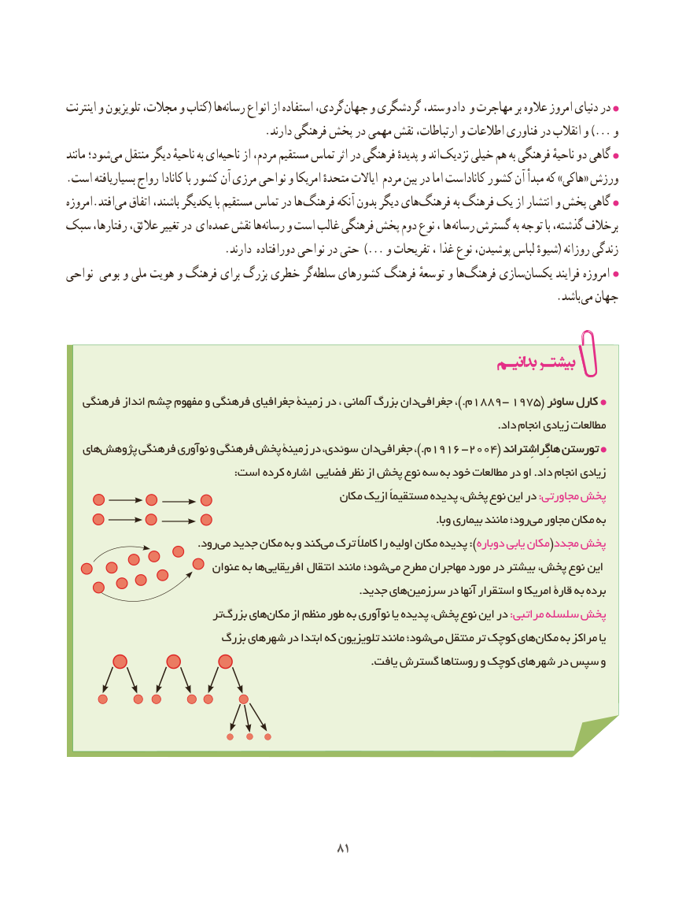

# PDF page 89

اینترنت و تلویزیون مجالت، و کتاب( هارسانه‌     انواع از استفاده گردی، جهان و گردشگری ستد، و داد و مهاجرت بر عالوه امروز دنیای در
                                    .دارند فرهنگی پخش در مهمی نقش ارتباطات، و اطالعات فناوری در انقالب و ...) و
مانند شود؛می‌  منتقل دیگر ناحیهٔ به ایناحیه‌     از مردم، مستقیم تماس اثر در فرهنگی پدیدهٔ و اند نزدیک خیلی هم به فرهنگی ناحیهٔ دو گاهی
.است بسیاریافته رواج کانادا با کشور آن مرزی نواحی و امریکا متحدهٔ ایاالت مردم بین در اما کاناداست کشور آن مبدأ که »هاکی« ورزش‌
امروزه.افتدمی‌   اتفاق باشند، یکدیگر با مستقیم تماس در ها فرهنگ آنکه بدون دیگر هایفرهنگ‌         به فرهنگ یک از انتشار و پخش گاهی
سبک رفتارها، عالئق، تغییر در ایعمده‌   نقش هارسانه‌    و است غالب فرهنگی پخش دوم نوع ، ها رسانه گسترش به توجه با گذشته، برخالف
                             .دارند دورافتاده نواحی در حتی ...) و تفریحات ، غذا نوع پوشیدن، لباس شیوهٔ( روزانه زندگی
نواحی بومی و ملی هویت و فرهنگ برای بزرگ خطری گرسلطه‌    کشورهای فرهنگ توسعهٔ و هافرهنگ‌     سازییکسان‌       فرایند امروزه
                                                                                         .باشد می جهان

   فرهنگی انداز چشم مفهوم و فرهنگی جغرافیای زمینۀ در ، آلمانی بزرگ دان جغرافی۱۸۸۹،.)م    - ۱۹۷۵( ساوئرساوئر کارلکارل
                                                                                                                         .داد انجام زیادی مطالعات
   های پژوهش فرهنگی نوآوری و فرهنگی پخش زمینۀ در سوئدی، دان جغرافی۱۹۱۶،.)م    - ۲۰۰۴( هاگِراشِتراندهاگِراشِتراند تورستنتورستن
                                               :است کرده اشاره فضایی نظر از پخش نوع سه به خود مطالعات در او .داد انجام زیادی
                                                مکان ازیک مستقیماً پدیده پخش، نوع این در :مجاورتی پخش
        .‌وبا بیماری مانند رود؛می مجاور مکان به
           .‌رودمی جدید مکان به و کندمی‌  ترک کامالً را اولیه مکان پدیده ):دوباره یابی مکان(مجدد پخش
                           عنوان به هاافریقایی‌        انتقال مانند شود؛می‌  مطرح مهاجران مورد در بیشتر پخش، نوع این
           .‌جدید هایسرزمین در آنها استقرار و امریکا قارۀ به برده
                             تر بزرگ هایمکان‌     از منظم طور به نوآوری یا پدیده پخش، نوع این در :مراتبی سلسله پخش
                         بزرگ شهرهای در ابتدا که تلویزیون مانند شود؛ می منتقل تر کوچک های مکان به مراکز یا
                                                                                     .یافت گسترش روستاها و کوچک شهرهای در سپس و

                                          8181

