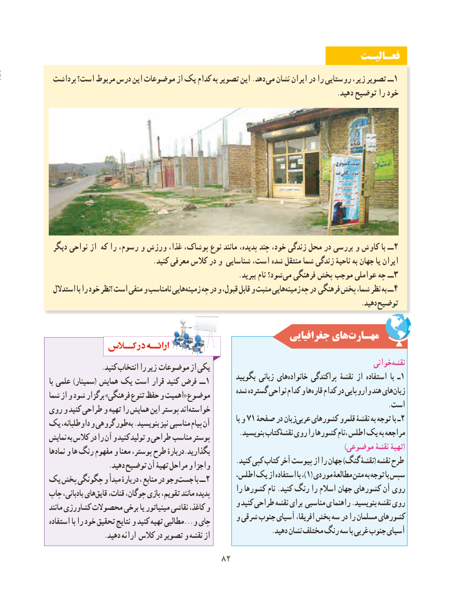

# PDF page 90

فعـالیـت
 برداشت است؟ مربوط درس این موضوعات از یک کدام به تصویر این .دهد می نشان ایران در را روستایی زیر، تصویر ــ1
                                                                                     .دهید توضیح را خود

 دیگر نواحی از که را رسوم، و ورزش غذا، پوشاک، نوع مانند ،‌پدیده چند خود، زندگی محل در بررسی و کاوش با ــ2
                               .کنید معرفی کالس در و شناسایی است، شده منتقل شما زندگی ناحیۀ به جهان یا ایران
        .‌ببرید نام شود؟ می فرهنگی پخش موجب عواملی چه ــ 3
 استدالل با را خود ؟نظر است منفی و نامناسب هاییزمینه‌    چه در و قبول، قابل و مثبت هاییزمینه‌    چه در فرهنگی پخش شما، نظر به ــ4
                                                                                             .دهید توضیح

                                                      جغرافیایی هایمهـارت‌

                                                                                        خوانی‌نقشه                .کنید انتخاب را زیر موضوعات از یکی
                                                        بگویید زبانی هایخانواده‌      پراکندگی نقشۀ از استفاده با ـ 1با علمی )سمینار( همایش یک است قرار کنید فرض ــ1
                                                  شده گسترده نواحی کدام و هاقاره‌   کدام در واروپایی هند هایزبان‌شما از و شود برگزار »فرهنگی تنوع حفظ و اهمیت« موضوع
                                                                                                     .استروی و کنید طراحی و تهیه را همایش این پوستر اندخواسته‌
                                                                                        با و 71 صفحۀ در زبانعربی‌   کشورهای قلمرو نقشۀ به توجه با ـ2یک داوطلبانه، و گروهی طور به .بنویسید نیز مناسبی پیام آن
                                                        .بنویسید نقشۀکتاب روی را کشورها ،نام اطلس یک به مراجعهنمایش به کالس در را آن و کنید تولید و طراحی مناسب پوستر
                                                                                                                                )موضوعی نقشۀ تهیۀ(نمادها و ها رنگ مفهوم و معنا پوستر، طرح دربارۀ.بگذارید
                                                        .کنید کپی کتاب آخر پیوست از را جهان )گنگ نقشۀ( نقشه طرح                  .دهید توضیح آن تهیۀ مراحل و واجزا
                                                اطلس، یک از استفاده با ،)1( موردی مطالعۀ متن به توجه با سپسیک پخش چگونگی و مبدأ دربارۀ ، منابع در وجو ‌جست با ــ 2
                                                          را کشورها نام .کنید رنگ‌     را اسالم جهان کشورهای آن رویچاپ بادبانی، هایقایق‌   قنات، چوگان، بازی تقویم، مانند پدیده
                                            و کنید طراحی نقشه برای مناسبی ی راهنما .بنویسید نقشه رویمانند کشاورزی محصوالت برخی یا مینیاتور نقاشی کاغذ، و
                                            و شرقی جنوب آسیای افریقا، بخش سه در را مسلمان کشورهایاستفاده با را خود تحقیق نتایج و کنید تهیه مطالبی...و چای
                                                                  .دهید نشان مختلف رنگ سه با غربی جنوب آسیای                .دهید ارائه کالس در تصویر و نقشه از
                                   8282

