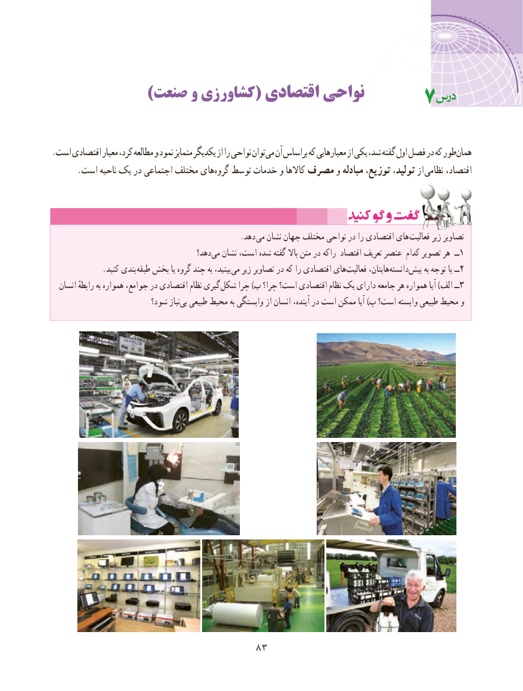

# PDF page 91

)صنعت و کشاورزی( اقتصادی نواحی                                 7

.است اقتصادی معیار کرد، مطالعه و نمود متمایز یکدیگر از را نواحی توانمی‌  آن براساس که معیارهایی از یکی شد، گفته اول فصل در که طورهمان‌
.‌است ناحیه یک در اجتماعی مختلف هایگروه توسط خدمات و کاالها مصرف و مبادله توزیع، تولید، از نظامی اقتصاد،

                                                .دهد می نشان جهان مختلف نواحی در را اقتصادی های فعالیت زیر تصاویر
                                        دهد؟‌می نشان است، شده گفته باال متن در راکه اقتصاد تعریف عنصر کدام تصویر هر  ــ1
             .کنید بندی طبقه بخش یا گروه چند به بینید،  می زیر تصاویر در که را اقتصادی هایفعالیت‌       هایتان،دانسته‌         ‌پیش به توجه با ــ2
  انسان رابطهٔ به همواره جوامع، در اقتصادی نظام گیری‌شکل چرا )ب چرا؟ است؟ اقتصادی نظام یک دارای جامعه هر همواره آیا )الف ــ3
                        شود؟ نیازبی‌  طبیعی محیط به وابستگی از انسان آینده، در است ممکن آیا )پ است؟ وابسته طبیعی محیط و

                                 8383

